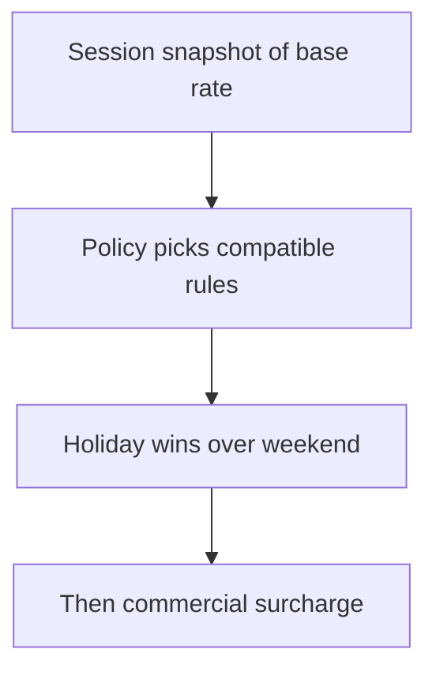
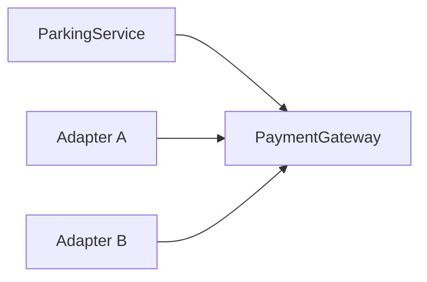
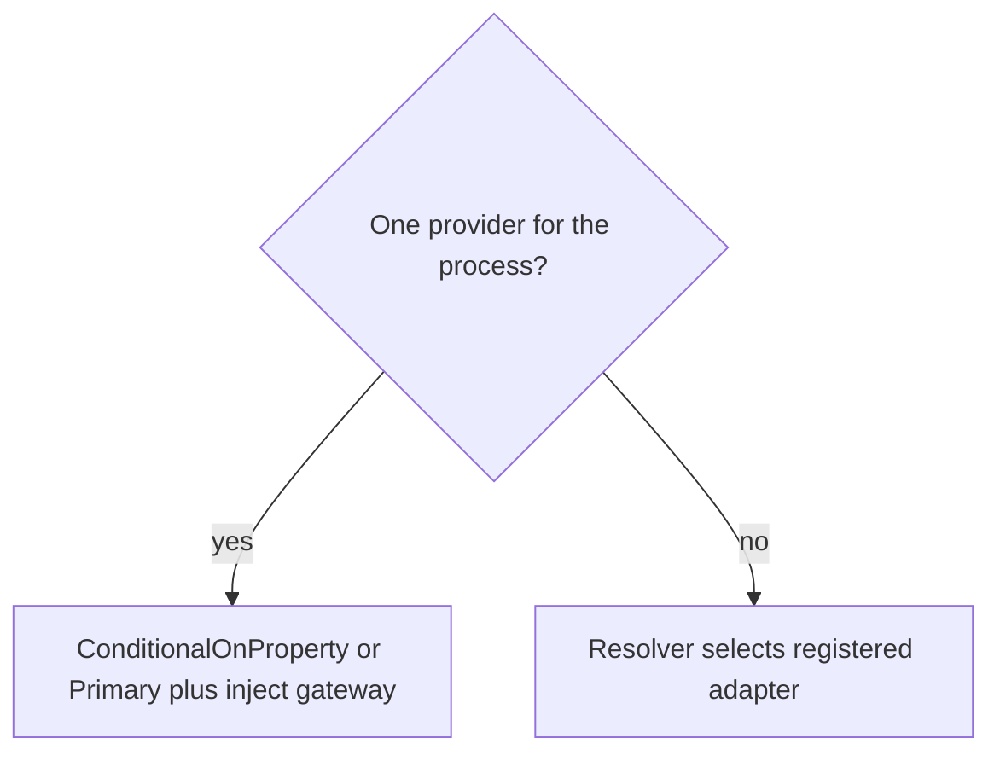

# Companion 6 — OCP and DIP

**Canonical source:** [Mastery Lesson 6](../../../01-engineering-mastery/lld/module-05-lld/06-ocp-and-dip.md).

**Cheat sheet:** [Visual quick reference](module-visual-quick-reference.md).

## Definition

**OCP:** extend stable behavior through data or new types behind an existing abstraction, instead of adding another branch to the same method. **DIP:** `ParkingService` depends on `PaymentGateway`; vendor adapters implement it. **DI** only supplies objects — it does not create that abstraction.

## Must remember

- Same formula, different rates → YAML or map. No strategy class per vehicle.
- Weekend **or** holiday multiplier, not both compounded; commercial surcharge **after**. Example: base 200, holiday ×2, surcharge 50 → **450**.
- Snapshot the rate (or policy version) at **session start**. Retries use that amount.
- `@Qualifier` / `@Primary` / `@ConditionalOnProperty` wire beans at **startup**. They do not pick a provider per request.
- A resolver is for location, tenant, or request when **several** gateways are registered together.
- Resolver ≠ adapter. Adapter translates; resolver selects.
- Provider C: new adapter + registration + config. `ParkingService` stays if the contract already fits.

## Interview traps

- “OCP means never edit code” — you still add the extension point and registration.
- One strategy class per hourly rate.
- A priority number replaces a written conflict policy.
- Injecting a vendor SDK client with Spring and calling it DIP.
- Changing `parking.provider=other` hot-swaps the running bean.

## Interview flow — pricing

## Interview flow — payment

## App-wide vs per request

## Scenario bite

Exit payment retries after a timeout. The fee was computed from the rate stored on the session, not from tonight’s YAML. The gateway call uses the same idempotency key and the same amount. The service still only sees `PaymentGateway`.

## Decision table

| Situation | Prefer |
| --- | --- |
| CAR 50, BIKE 20, BUS 100, same formula | Configured rates |
| Holiday vs weekend multipliers | `PricingRule` + `PricingPolicy` |
| One PSP for the deployment | `@ConditionalOnProperty` or `@Primary` |
| PSP depends on parking location | `PaymentGatewayResolver` |
| This constructor must get one named bean | `@Qualifier` |

## Explain aloud (whiteboard)

1. “Rates that share a formula stay in configuration.”
2. “Holiday replaces weekend; surcharge is after; I test that combination.”
3. “The service depends on our gateway interface; a new provider is an adapter plus registration, not an edit to exit logic.”

## 30-second revision

- OCP: data vs behavior vs policy. DIP: depend on `PaymentGateway`. DI ≠ DIP. Conditional config is startup. Resolver is runtime among live beans. Session fee is snapshotted.

## Memory hook

- **CDR** — **C**onfig for rates, **D**IP for vendors, **R**esolver only if selection is per request.

## Cross-links

- [Lesson 1 companion — Strategy vs switch](01-lld-foundations-what-senior-lld-interviews-evaluate.md)
- [Lesson 2 — rate at entry](02-requirement-clarification-and-scope.md)
- [Lesson 3 — pricing vs payment ownership](03-domain-modeling-and-class-responsibilities.md)
- [Lesson 4 — payment failure keeps the spot](04-encapsulation-invariants-and-tell-dont-ask.md)
- [Lesson 5 — config, adapters, registry](05-abstraction-composition-and-pattern-selection.md)
- [Visual quick reference](module-visual-quick-reference.md)
