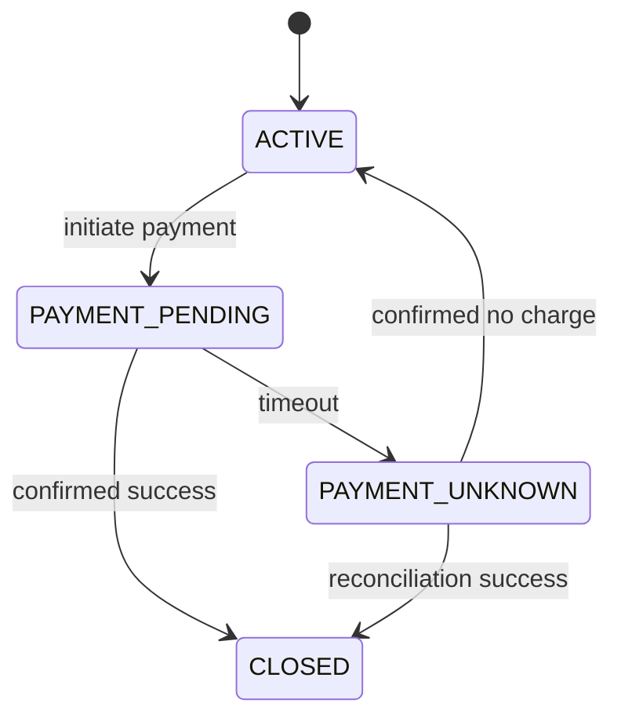
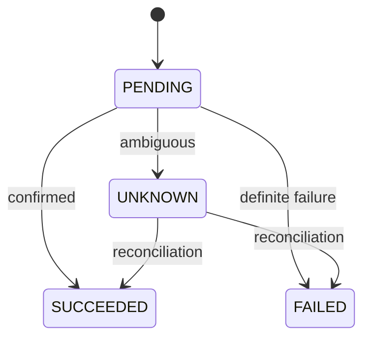
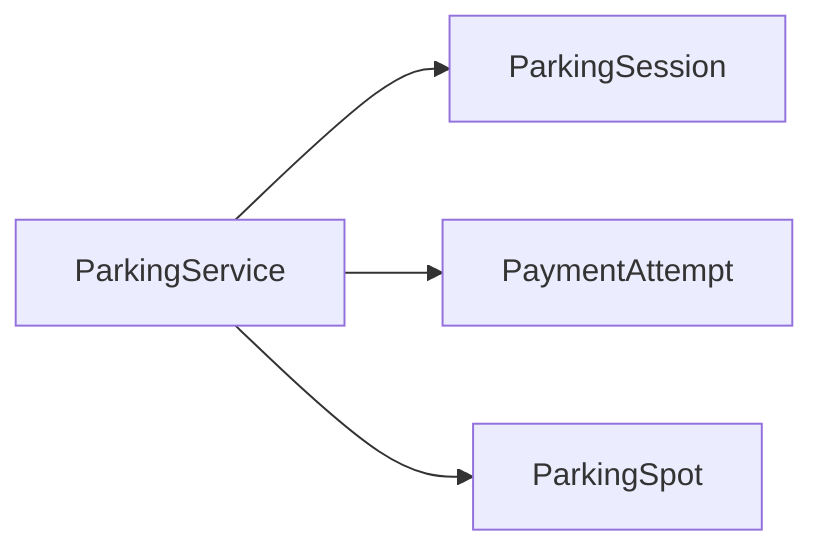
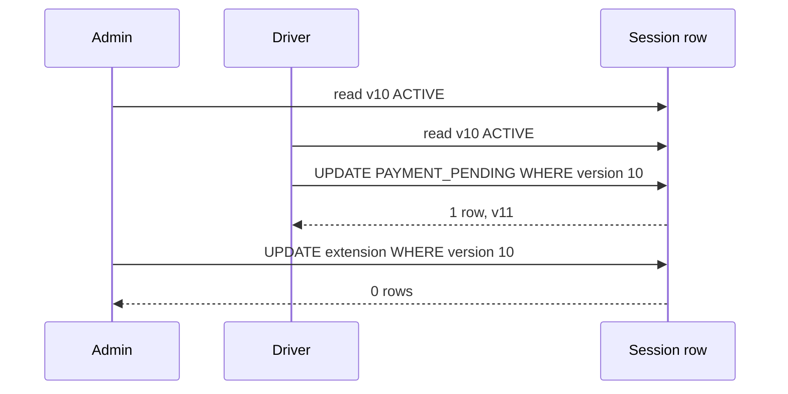
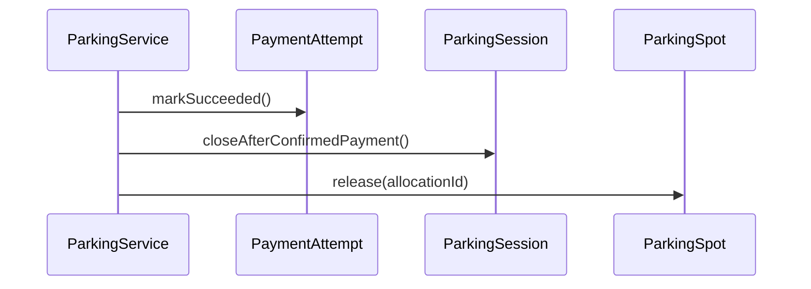

# Companion 7 — State Modeling and Transitions

**Canonical source:** [Mastery Lesson 7](../../../01-engineering-mastery/lld/module-05-lld/07-state-modeling-and-transitions.md).

**Cheat sheet:** [Visual quick reference](module-visual-quick-reference.md).

## Definition

A lifecycle state is a mode that changes which operations are legal. The entity that owns the state guards the arrows. `ParkingService` sequences session, payment attempt, and spot. It does not set their fields.

## Must remember

- Session: `ACTIVE → PAYMENT_PENDING → CLOSED`, with `PAYMENT_UNKNOWN` when the provider result is ambiguous. Confirmed failure from unknown returns to `ACTIVE`.
- Payment attempt: `PENDING`, `UNKNOWN`, `FAILED`, `SUCCEEDED`. A timeout is not `FAILED`.
- Spot stays `OCCUPIED` until a confirmed payment and `release(allocationId)`.
- Grace extension is a once-only fact on an `ACTIVE` session, not a new `SessionStatus`.
- Enum plus guarded methods until per-state behavior is large. The State pattern does not replace the service, and state classes do not call the provider.
- `@Version` or a conditional `UPDATE ... WHERE status = 'ACTIVE' AND version = ?`. One wins. Do not combine both version styles on the same write.
- Optimistic conflict: reload and re-decide. Do not replay the extension after payment has started.
- Provider HTTP is outside the database transaction. If the charge succeeded and the local commit failed, retry the local close and release. Do not charge again.

## Interview traps

- `setStatus(CLOSED)` from the service.
- One enum for both the visit and the payment provider.
- `GRACE_PERIOD_EXTENDED` as a session state for a single extension.
- State pattern because there are four constants.
- `if (status == ACTIVE)` in Java treated as a cross-JVM lock.
- `FOR UPDATE` held during the provider call.
- Blind retry after `OptimisticLockException`.
- Timeout stored as failure, or spot released before success.

## Session and payment

## Who moves

## Race

## Reconciliation

## Scenario bite

The driver and an administrator both read `ACTIVE` at version 10. Payment initiation wins. The extension updates zero rows. The UI reloads `PAYMENT_PENDING` and refuses a retry of the same extension. The spot is still occupied. The fee on the session is unchanged.

## Decision table

| Situation | Prefer |
| --- | --- |
| Four statuses, small guards | Enum methods |
| Large behavior that really changes per mode | State pattern |
| One grace extension while parked | Fields on the session |
| Approval workflow for a second extension | Separate entity |
| Rare conflicts on one row | Optimistic update with status predicate |
| Hot row, short critical section, no HTTP inside | `SELECT … FOR UPDATE` |
| Provider timeout | `UNKNOWN`, reconcile, do not release |

## Explain aloud (whiteboard)

1. “The session, the attempt, and the spot each own an arrow. The service only orders the calls.”
2. “Extension is data. It is legal only in `ACTIVE`, and the `UPDATE` says that in the `WHERE` clause.”
3. “A timeout is unknown money. I close and release only after confirmed success, in one local transaction, with the provider call already outside it.”

## 30-second revision

- Separate lifecycles. Enum first. No setters. Version plus status predicate. Conflict means reload. HTTP outside the transaction. Unknown is not failure. Spot stays occupied.

## Memory hook

- **SOA** — **S**ession, attempt, and spot are separate; **O**wners guard arrows; **A**tomic `WHERE` decides the race.

## Cross-links

- [Lesson 4 — release by allocation id](04-encapsulation-invariants-and-tell-dont-ask.md)
- [Lesson 6 — gateway and idempotency](06-ocp-and-dip.md)
- [Visual quick reference](module-visual-quick-reference.md)
