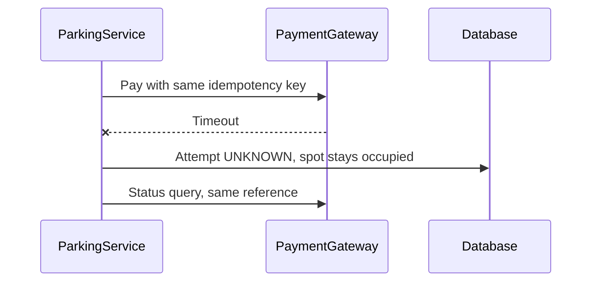
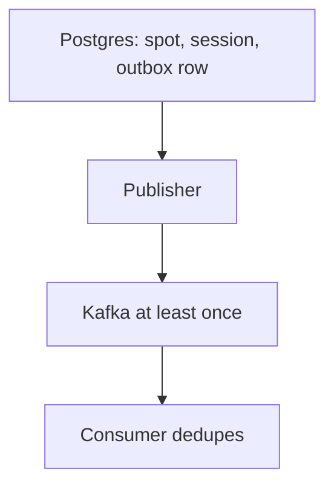

# Companion 8 — Error Handling and Failure Modeling

**Canonical source:** [Mastery Lesson 8](../../../01-engineering-mastery/lld/module-05-lld/08-error-handling-and-failure-modeling.md).

**Cheat sheet:** [Visual quick reference](module-visual-quick-reference.md).

## Definition

Failure handling classifies the outcome, protects invariants, and recovers when the result is unknown. A timeout is not a decline. `@RestControllerAdvice` only maps HTTP exceptions. It does not repair spots or payments.

## Must remember

- No compatible spot is a business result. Do not return `null` or a stack trace. Vehicle-already-parked is a 409 after a **specific** constraint translation.
- `PaymentProviderTimeoutException` means unknown. Reuse the idempotency key. Keep the session and the spot. Reconcile.
- Catch to record that unknown state. Translate a known PostgreSQL constraint at the repository. Do not catch-log-rethrow.
- Advice does not run for Kafka listeners or scheduled jobs.
- Deadlock retry is a **new** transaction of the whole unit of work. Optimistic conflicts reload. Do not retry bad SQL.
- Idempotency key: one logical HTTP call, stored in Postgres. Partial unique index `uq_active_vehicle_session` (PostgreSQL only): one open visit per vehicle. Different jobs.
- Lost commit ack: do not assume rollback. Read the idempotency row.
- `@Transactional` does not cover Redis or Kafka. Redis is not the allocation authority. Outbox row commits with the session. Duplicates are possible. Consumers dedupe. Not exactly once.
- Saga compensation is a new cancel plus `release(allocationId)`, not `ROLLBACK`. Timeout holds the spot. Expiry is a separate policy. A late approval must not reclaim a newer allocation.
- `COMPENSATION_PENDING` is durable. One worker claims the row with a lease. Compensation itself can fail.

## Interview traps

- Timeout marked `FAILED`, or a new payment key on retry.
- Every `DataIntegrityViolationException` becomes “already parked.”
- Business recovery inside `@RestControllerAdvice`.
- “`@Transactional` writes Postgres, Redis, and Kafka atomically.”
- Outbox described as exactly once.
- Compensation described as rollback, or history deleted.
- Spot released on authorization timeout with no business expiry rule.
- Two reconcilers and no `UPDATE ... WHERE recovery_owner IS NULL`.
- At-least-once warehouse merge called a saga.

## Timeout

## Outbox and saga

Authorization in another service is a saga: reject starts `COMPENSATION_PENDING`, then cancel and release that allocation id. A late approval checks the allocation id.

## Scenario bite

Entry commits, the HTTP response is lost, and the client retries the same key. The second instance finds the completed idempotency row and returns the same session. A different key for the same vehicle hits `uq_active_vehicle_session` and becomes 409, not a second spot. A payment timeout after exit does not free that spot and does not send a new charge key.

## Decision table

| Situation | Do |
| --- | --- |
| Lot full | Result or mapped business code, no session |
| Same request retried | Stored idempotency record |
| Second open visit, new key | Partial unique index |
| Provider timeout | `UNKNOWN`, same key, reconcile |
| Deadlock | Retry entire transaction |
| Optimistic conflict | Reload and re-decide |
| Event after commit | Outbox, not a second commit protocol |
| Another service must approve | Saga, durable compensation |
| Stuck compensation | Claimed reconciler, lease, alert |

## Explain aloud (whiteboard)

1. “I separate no-spot, already-parked, decline, and timeout. Only the timeout is uncertain, and I will not free the spot or change the idempotency key.”
2. “The partial index is the vehicle invariant. The idempotency table is the HTTP retry. I translate only `uq_active_vehicle_session`.”
3. “Postgres commit is the entry. Kafka is an outbox. A second service is a saga whose undo is a new write, claimed by one worker, and a late yes cannot steal the spot.”

## 30-second revision

- Classify, then catch. Advice is HTTP-only. Timeout stays unknown. One database per local transaction. Outbox is at least once. Saga undo can fail. Claim the repair. Check allocation id on late replies.

## Memory hook

- **TURBO** — **T**imeout is unknown, **U**nique index is not the idempotency key, **R**etry whole transactions only, **B**ox the event in the same commit, **O**ne worker owns compensation.

## Cross-links

- [Lesson 4 — allocation id](04-encapsulation-invariants-and-tell-dont-ask.md)
- [Lesson 6 — gateway](06-ocp-and-dip.md)
- [Lesson 7 — UNKNOWN and locks](07-state-modeling-and-transitions.md)
- [Mastery Lesson 8](../../../01-engineering-mastery/lld/module-05-lld/08-error-handling-and-failure-modeling.md)
