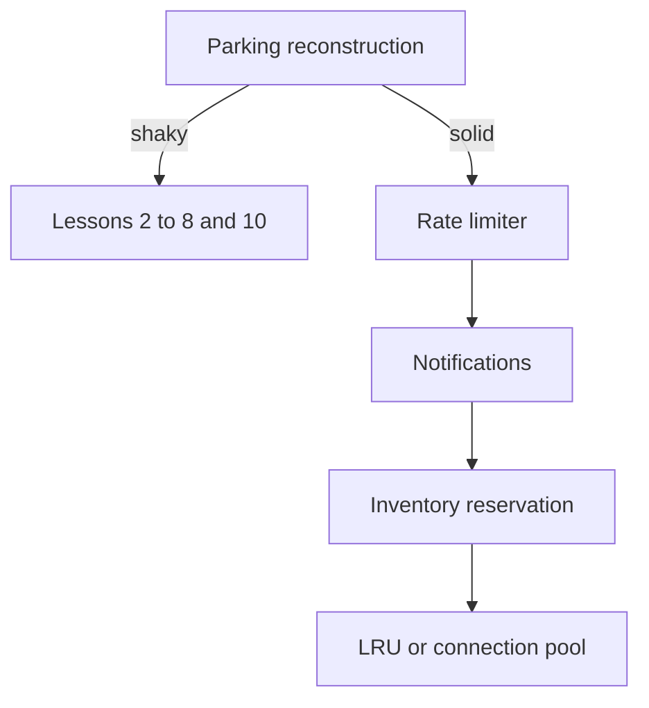

# Companion 9 — Practice transfer

**Canonical source:** [Mastery Lesson 9](../../../01-engineering-mastery/lld/module-05-lld/09-practice-transfer-problems.md).

## Must remember

- Lessons 1–8 and 10 **are** the parking-lot curriculum. Lesson 9 does not invent a second lot.
- Missing names, not missing parking design: **LSP**, **ISP**, Abstract Factory, Template Method, Command, Chain of Responsibility, Proxy.
- Practice order: reconstruct parking → rate limiter → notifications → inventory reservation.
- Movie tickets and payments are transfer drills. Skip them if reconstruction was solid.
- One JVM lock is not a shared inventory or rate limit.

## Decision table

| Interview prompt | What you say first |
| --- | --- |
| Design a parking lot | Claim, snapshot rate, allocation id, `UNKNOWN`, then `SKIP LOCKED` only if they ask about scale |
| Design a rate limiter | Window policy, then one JVM vs Redis, then fail open or closed |
| Design notifications | Channel list and per-channel result. Observer only if subscribers are open-ended |
| Design inventory | `UPDATE ... WHERE available >= qty`. Do not lock in Java across instances |
| Add a pattern | Name the variation. Otherwise configuration, one method, or an adapter at the vendor |

## Pattern skip lines

| They ask | You answer |
| --- | --- |
| Abstract Factory | Only if two products must be created as a matching pair |
| Template Method | Only if the step order is fixed and one hook changes |
| Command | Only if the work is queued or retried as data |
| Chain of Responsibility | Only if handlers are added or reordered independently |
| Proxy | Access or lazy stand-in. A foreign API is an Adapter |
| LSP | A `CarSpot` that throws on `release` is not a `ParkingSpot` |
| ISP | The charge caller does not implement `saveCard` |

## Explain aloud

1. “I already designed the parking lot across the earlier lessons. I will rebuild it once from memory, then switch domains.”
2. “Three notification channels with known failures are a loop over senders, not an Observer.”
3. “Two app instances reserving stock need a conditional update. `synchronized` only helps inside one process.”

## Practice

1. Whiteboard the parking lot invariants in under ten minutes.
2. For a rate limiter, say what happens when the shared store times out.
3. For inventory, write the `UPDATE` predicate and the reservation states `HELD`, `CONFIRMED`, and `RELEASED`.
