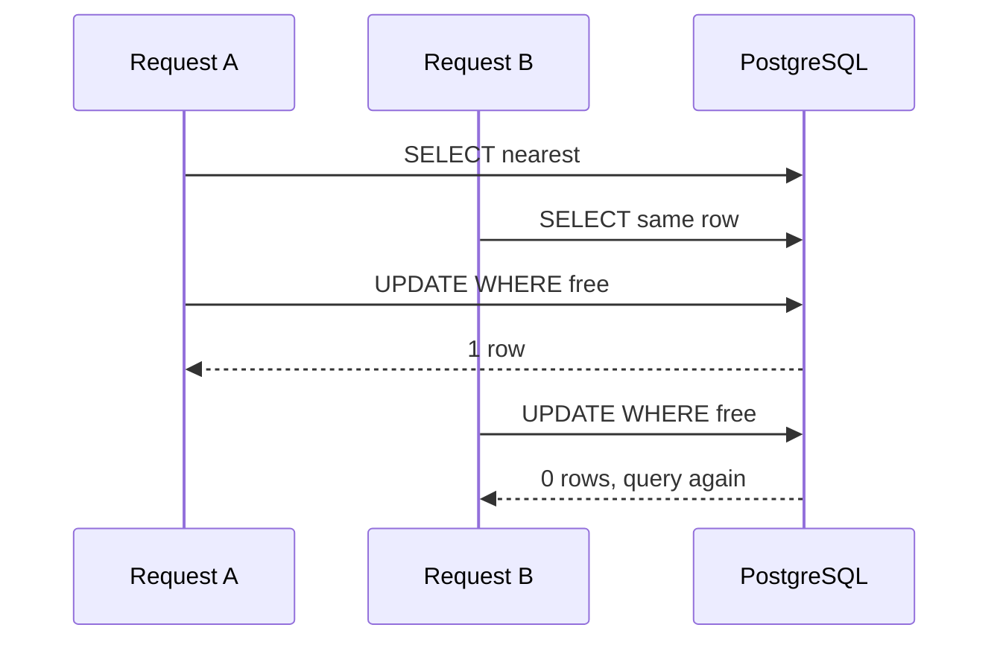
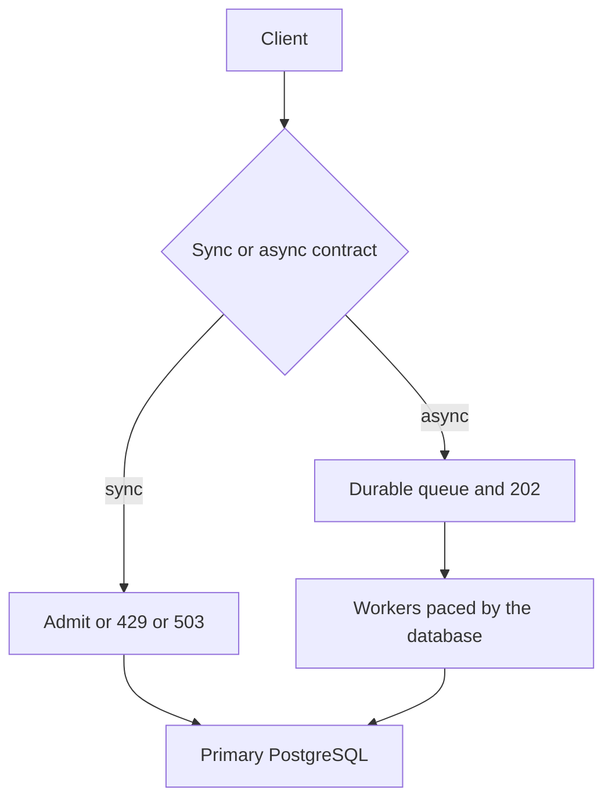

# Companion 10 — Performance, Scalability, and Optimization

**Canonical source:** [Mastery Lesson 10](../../../01-engineering-mastery/lld/module-05-lld/10-performance-scalability-and-optimization.md).

**Cheat sheet:** [Visual quick reference](module-visual-quick-reference.md).

Practice transfer is [Lesson 9](09-practice-transfer-problems.md). This page is the Lesson 10 cram.

## Definition

Performance is latency and throughput at a load. Scalability is whether throughput can grow without dropping a business rule. Strict “nearest compatible stall” serializes the **decision**. A conditional `UPDATE` only serializes **one row**.

## Must remember

- Trace a jump from 100 ms to 2 s before rewriting Java. Split pool wait, lock wait, SQL, Redis, and HTTP. PostgreSQL CPU percent is not the whole diagnosis.
- Filter, order, and `LIMIT 1` in PostgreSQL. A partial composite index on free spots can cover equality columns plus `distance_from_entrance, spot_id`. The planner may still seq-scan. `EXPLAIN (ANALYZE, BUFFERS)` runs the query.
- `synchronized` is one JVM. Claim with `UPDATE ... WHERE occupied = FALSE`. 1 row wins, 0 rows means pick a **new** candidate. Empty lookup is `NoAvailableSpotException`. Exhausted races are `AllocationContentionException`. Connection and deadlock errors are technical.
- Put `allocation_id` on that same `UPDATE`. Insert the session in the same transaction. `@Transactional` must be on another Spring bean, not `this`.
- `FOR UPDATE` waits and rechecks a row that was taken. It does not rewind to a closer stall released after the scan passed it. `SKIP LOCKED` can take a farther stall while a closer one is locked and later rolls back.
- Strict nearest: allocate **and** release take the facility lock. That lock is the throughput cap.
- SQL at 20 ms can sit in an 800 ms transaction. The Hikari connection is held the whole time. A larger pool can add lock and disk contention.
- 10 million arrivals and 5,000 completions/s: bound the door. Sync returns 429 or 503. Async is an explicit 202 plus a stored id. A queue is not extra database capacity.
- Kafka order is per partition. `lotId:vehicleType` splits cars and bikes. More consumers do not split one partition. Database commit order can differ from record order if handling is concurrent.
- Replicas are not authoritative for claims. Partitioning is one cluster. Sharding is many primaries. A standby is not a writable shard. PgBouncer does not add compute.
- Cache-aside invalidates after commit. A failed `DEL` or a stale refill needs an outbox. Outbox is at-least-once, not exactly once.
- Single-flight shares one in-flight **read** per JVM (`putIfAbsent`, `remove(key, future)`, `copy()` so one timeout does not cancel everyone). Do not coalesce two allocations.

## Interview traps

- “The conditional update means we always get the nearest stall.”
- `SKIP LOCKED` as the strict-nearest design.
- Facility lock on allocate only, while release is unlocked.
- Bigger Hikari pool as the fix for `idle in transaction`.
- Allocation decided from Redis or a replica.
- “Outbox is exactly once.”
- `orTimeout` on the shared `CompletableFuture`.
- Turning a synchronous allocate API into Kafka without saying the contract changed.
- Calling table partitioning a shard.

## Optimistic claim

## Backpressure

## Scenario bite

Two pods read stall 101 at 10 m. Pod A’s `UPDATE` changes 1 row and inserts the session. Pod B’s `UPDATE` changes 0 rows and searches again. Meanwhile stall 99 at 5 m is released without a facility lock, and A has already kept 101. Double occupancy did not happen. Strict nearest did not happen either.

## Decision table

| Need | Use |
| --- | --- |
| One winner per stall | Conditional `UPDATE` |
| Strict nearest for the lot | Same lock on allocate and release |
| Nearby stall is acceptable | Optimistic claim or `SKIP LOCKED` |
| Job queue, skip busy rows | `FOR UPDATE SKIP LOCKED` |
| Burst larger than claim rate | 429/503 or explicit 202, bounded workers |
| Config read stampede | Single-flight, then real cache |
| Cache invalidation after crash | Outbox in the same commit |

## Explain aloud (whiteboard)

1. “I measure the span. If it is lock wait or a connection held idle, I do not start with a new index.”
2. “The update is atomic for that row. Nearest-at-commit needs the release path on the same facility lock, and I will quote the throughput that lock allows.”
3. “Kafka can accept work in parallel. It does not allocate in parallel beyond what one primary and one decision lock can commit.”

## 30-second revision

- Measure first. Claim in SQL. Nearest is a protocol, not a `SELECT`. `SKIP LOCKED` relaxes it. Short transactions. Bound admission. Primary for occupancy. Outbox for invalidate. Coalesce reads only.

## Memory hook

- **NEAR** — **N**earest needs one lock with release, **E**xtra threads do not add throughput, **A**tomic update is per row, **R**efuse or 202 when the database is the cap.

## Cross-links

- [Lesson 4 — allocation id](04-encapsulation-invariants-and-tell-dont-ask.md)
- [Lesson 7 — short transactions](07-state-modeling-and-transitions.md)
- [Lesson 8 — idempotency and outbox](08-error-handling-and-failure-modeling.md)
- [Mastery Lesson 10](../../../01-engineering-mastery/lld/module-05-lld/10-performance-scalability-and-optimization.md)
