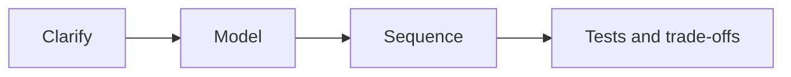
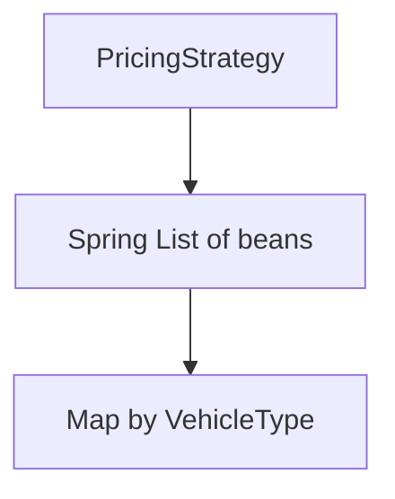
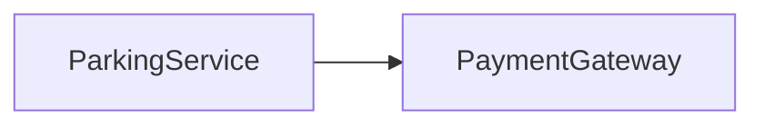

# LLD — Visual Quick Reference

## Workflow

## LLD vs HLD

| LLD | HLD |
| --- | --- |
| Classes and methods | Services and data stores |
| One parking fee API | Multi-region payments |

## Strategy stack

| Choice | When |
| --- | --- |
| switch | Two stable rates |
| Strategy + map | Rules diverge, unit-test each |
| Spring list | Many beans, fail fast on duplicate keys |

| Failure | When |
| --- | --- |
| Duplicate key | Startup |
| Unknown vehicle | Request 4xx |

## Lessons 2–5 (parking lot)

| Lesson | Remember |
| --- | --- |
| 2 | Session only after claim; rate at entry; payment failure keeps the spot |
| 3 | Spot owns occupancy; no floor class; service orchestrates |
| 4 | `tryOccupy` returns an allocation id; `release` must match it |
| 5 | Same formula → config; vendor API → adapter; provider id → registry |

- [L2](02-requirement-clarification-and-scope.md)
- [L3](03-domain-modeling-and-class-responsibilities.md)
- [L4](04-encapsulation-invariants-and-tell-dont-ask.md)
- [L5](05-abstraction-composition-and-pattern-selection.md)
- [Lesson 1 companion](01-lld-foundations-what-senior-lld-interviews-evaluate.md)
- [Lesson 6 companion — OCP and DIP](06-ocp-and-dip.md)

## OCP vs DIP (Lesson 6)

| Change | Where it lands |
| --- | --- |
| New hourly rate, same formula | Config map — not a new strategy class |
| Holiday replaces weekend; surcharge after | `PricingPolicy` — holiday ×2 then +50 on base 200 is 450 |
| New payment vendor | New `PaymentGateway` adapter + registration |

`@ConditionalOnProperty` registers one provider at startup. A resolver selects among several live adapters per location or request. Changing a property does not replace a bean in a running context.

## State transitions (Lesson 7)

| Owner | Arrow |
| --- | --- |
| Session | `ACTIVE` → `PAYMENT_PENDING` → `CLOSED`; timeout is `PAYMENT_UNKNOWN` |
| Payment attempt | `PENDING` / `UNKNOWN` / `FAILED` / `SUCCEEDED` — timeout is not failure |
| Spot | Stays occupied until `release(allocationId)` after confirmed payment |

Grace extension is a once-only field on an `ACTIVE` session. The winning write is one `UPDATE` with `status` and `version` in the `WHERE` clause. A conflict reloads; it does not replay the extension. Provider HTTP stays outside that transaction.

- [Lesson 7 companion](07-state-modeling-and-transitions.md)

## Failure modeling (Lesson 8)

| Outcome | Treatment |
| --- | --- |
| No compatible spot | Business result, no session |
| Provider timeout | `UNKNOWN`, same idempotency key, spot stays occupied |
| Lost HTTP response after commit | Stored idempotency record |
| Second open visit | PostgreSQL partial unique index, not the same mechanism as the key |
| Kafka after commit | Outbox in the same Postgres transaction; consumers dedupe |
| Another service must approve | Saga; compensation is a new cancel plus `release(allocationId)` |

`@RestControllerAdvice` maps request exceptions only. A reconciler claims `COMPENSATION_PENDING` with a lease. A late approval must not reclaim a newer allocation.

- [Lesson 8 companion](08-error-handling-and-failure-modeling.md)

## Performance (Lesson 10)

| Choice | What you give up |
| --- | --- |
| Conditional `UPDATE` | Double occupancy. Not strict nearest |
| Facility lock on allocate and release | Throughput at that lot |
| `SKIP LOCKED` | A closer stall can lose if its transaction rolls back |
| Bigger Hikari pool | Often more lock and disk wait |
| Kafka consumers | Ingestion parallelism, not a faster primary |

- [Lesson 10 companion](10-performance-scalability-and-optimization.md)

## Practice picker (Lesson 9)

| Next drill | Stop when |
| --- | --- |
| Rebuild parking from memory | Claim, snapshot rate, allocation id, `UNKNOWN` are missing |
| Rate limiter | You have not said one JVM versus a shared store |
| Notifications | You reached for Observer before a channel list |
| Inventory reservation | The atomic write is still a Java lock |

- [Lesson 9 companion](09-practice-transfer-problems.md)
