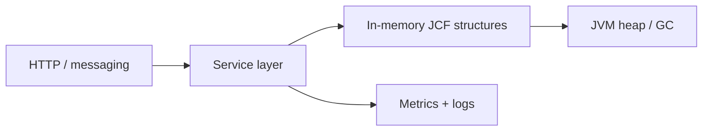

# Module 6 — Java 8 Streams production playbook

Runbook for teams operating Spring Boot / JVM services where **java 8 streams** choices
affect latency, memory, and incident response.

## Overview

Covers detection, mitigation, and verification for production issues tied to Module 6
lessons. Concepts live in [Engineering Mastery](../../01-engineering-mastery/core-java/module-06-java-8-streams/index.md).

## When to use this

- Elevated latency or CPU after a release touching domain collections or APIs
- `OutOfMemoryError`, GC churn, or thread pool exhaustion linked to in-memory structures
- Interview prep for "debug this production service" scenarios

## Prerequisites

- JDK 17+ tooling: `jcmd`, `jmap`, `jfr`, async-profiler
- Read access to logs and metrics; approval for heap dumps in prod

## Architecture in production

## Procedure

1. **Triage** — classify as correctness (exceptions), capacity (GC/OOM), or contention.
2. **Correlate** — deploy time, traffic shape, and dependency latency.
3. **Capture** — thread dump; if memory, histogram or heap dump per policy.
4. **Mitigate** — feature flag, rate limit, bounded queue, or cache cap.
5. **Verify** — p95 latency, error rate, heap stable after full GC cycle.

## Configuration

- Set explicit pool and queue capacities; avoid `Integer.MAX_VALUE` defaults.
- JVM: document heap (`-Xmx`), metaspace, and GC algorithm flags per environment.

## Monitoring and JDK diagnostics

- Metrics: heap used, GC pause, pool depth, cache entry count.
- Logs: structured fields for collection sizes where expensive to compute (sampled).

## Failure scenarios and recovery

| Signal | Action |
| --- | --- |
| `ConcurrentModificationException` | Find concurrent mutation; switch to concurrent collections or copy-on-write |
| Rising old-gen after deploy | Diff collection caches; analyze dominators |
| Timeouts at integration | Check blocking queue depth and rejection policy |

## Performance and cost

- Right-size structures; avoid accidental boxing and mega-collections in hot paths.

## Security and governance

- Do not log full `Employee` / `Payment` payloads; redact PII.

## Rollback

- Revert release if mitigation fails; preserve heap dump artifact before rollback if safe.

## Incident checklist

- [ ] Exception class and stack captured
- [ ] Deploy correlation identified
- [ ] Mitigation validated on metrics
- [ ] Follow-up mastery lesson linked in postmortem

## Key takeaways

- Operate **bounds**, **ordering**, and **concurrency** explicitly.

## See also

- [Mastery module](../../01-engineering-mastery/core-java/module-06-java-8-streams/index.md)
- [Interview Companion module](../../02-interview-companion/core-java/module-06-java-8-streams/index.md)
