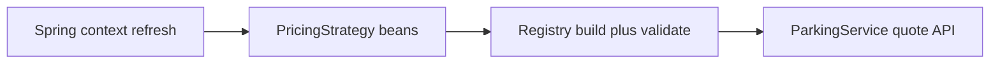

# Module 05 — LLD production playbook

Operational guidance for **pluggable strategy registries** (pricing, fees, tax rules) in Spring services. Concepts: [Mastery L1](../../01-engineering-mastery/lld/module-05-lld/01-lld-foundations-what-senior-lld-interviews-evaluate.md).

## When to use this

- Application **fails to start** after adding a pricing/fee bean
- Production quotes wrong fee after deploy (wrong strategy bean active)
- New vehicle type returns unexpected 500 instead of supported 4xx

## Architecture in production

## Procedure

1. **Triage** — startup failure vs runtime wrong quote vs unsupported type response.
2. **Startup failure** — read stack trace for `IllegalStateException` duplicate key or missing required type.
3. **Runtime wrong fee** — list active strategy beans (`/actuator/beans` if enabled); confirm `@Primary` not overriding registry; verify deploy tag.
4. **Unsupported type** — confirm product matrix; return 4xx with enum of supported types — not retry storm on 500.
5. **Verify** — smoke test each `VehicleType` after deploy; compare fee tables to config.

## Configuration

- Document `parking.required-vehicle-types` (or equivalent) per environment.
- Fail context refresh on duplicate `supports()` keys — never silent last-wins in production registry.

## Monitoring

- Metric: quote requests by `VehicleType` and outcome (success / unsupported / error).
- Alert: spike in unsupported types after marketing campaign (may need new strategy, not bug).

## Failure scenarios

| Signal | Action |
| --- | --- |
| Duplicate strategy at startup | Remove or merge conflicting `@Component`; one bean per key |
| Missing MOTORCYCLE in prod only | Config drift — sync required-types with staging |
| All quotes use car rate | Wrong map key on `supports()` — fix impl, add test |

## Incident checklist

- [ ] Capture startup log from failed deploy
- [ ] Enumerate `PricingStrategy` bean names in running vs previous version
- [ ] Run registry unit test in CI before rollback decision
- [ ] Post-incident: add startup validator test for new strategy

## Rollback

Revert release if validation was removed or duplicate beans shipped; preserve config diff for RCA.

## Cross-links

- [Interview companion — validation flow](../../02-interview-companion/lld/module-05-lld/01-lld-foundations-what-senior-lld-interviews-evaluate.md)
