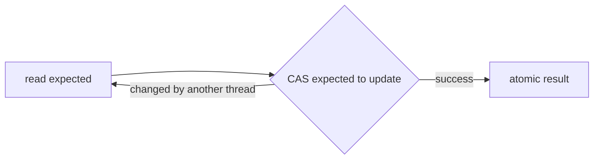

# Lesson 7 — Atomics and CAS

## CAS loop

```java
AtomicInteger counter = new AtomicInteger();
counter.incrementAndGet(); // CAS-based
```

Hardware compares memory, swaps if expected value matches — retry on failure.

## Limits

- Only safe for **well-defined** atomic variables — not arbitrary invariants spanning fields.
- High contention → CAS spin waste — consider `LongAdder`.

## AtomicInteger decision point

`AtomicInteger` represents one atomic variable. `incrementAndGet()` returns the incremented
value; `getAndIncrement()` returns the old value. Conceptually a CAS loop reads an expected
value, attempts to install the update only if it is still current, and retries after contention.
That retry is why a CAS algorithm can be lock-free without being wait-free: system-wide progress
can occur even if one caller repeatedly loses races.



Use it when the current counter/state must itself be atomic. It cannot protect a business rule
such as “debit one balance and credit another”; that needs a higher-level transaction or lock.

## Cross-links

- [Lesson 8 — LongAdder](08-longadder.md)
- [Lesson 19 — Patterns](19-thread-safety-patterns.md)
