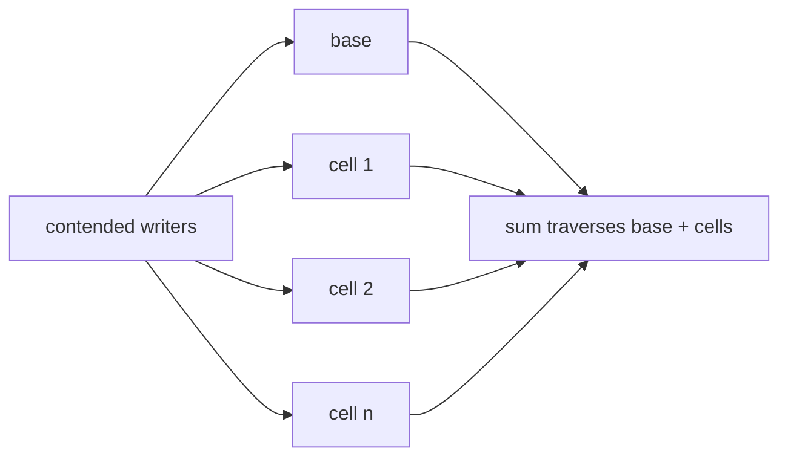

# Lesson 8 — `LongAdder`

## When to use

Many threads incrementing same counter — reduces CAS contention vs single `AtomicLong`.

```java
LongAdder hits = new LongAdder();
hits.increment();
long total = hits.sum(); // not atomic with concurrent adds — approximate for metrics OK
```

## Internal shape and correct interpretation

Under contention, `LongAdder` spreads updates across a base and dynamically used striped cells,
so competing writers do not all CAS one location. `sum()` combines them. During that traversal an
increment can land in a cell already read or not yet read, so it is **not an atomic snapshot**.
It does not mean successful increments are inherently lost: once writers quiesce, `sum()` reflects
the maintained total. The trade-off is extra memory and a non-linearizable read for substantially
better write throughput under contention.



| Need | Use |
| --- | --- |
| Atomic current counter value / sequence | `AtomicInteger` / `AtomicLong` |
| Heavily contended statistics | `LongAdder` |
| Financial ledger or exact coordinated update | database/lock/transaction model |

### What I should say in an interview

“`LongAdder` trades a linearizable `sum()` for striped, high-throughput writes, so it fits
metrics. If a decision depends on the exact current counter value, I use an atomic state model.”

## Trade-off

`sum()` is not a global atomic snapshot under heavy concurrent updates — fine for metrics, not for strict financial ledger without stronger model.

## Cross-links

- [Lesson 22 — CHM + LongAdder](22-backend-concurrency-scenarios.md)
