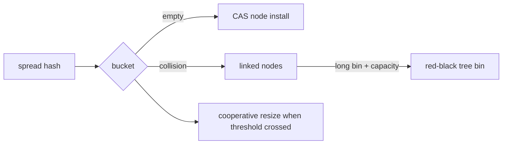

# Lesson 9 — Concurrent Collections

Expands [Collections M4 L12](../books/01-engineering-mastery/core-java/module-04-collections/12-concurrent-collections-overview.md).

## `ConcurrentHashMap`

- No null keys/values.
- `putIfAbsent`, `computeIfAbsent`, `merge` — single-key atomicity.
- Weakly consistent iterators.

## `ConcurrentHashMap` in Java 17

Modern `ConcurrentHashMap` is a table of bins, not the fixed Java 7 segment-lock architecture.
A spread hash selects a bin. Empty-bin insertion can succeed with CAS; contended nonempty-bin
updates synchronize only the relevant bin as needed. Collisions use linked nodes and may become
red-black tree bins after the implementation thresholds are met (in current OpenJDK, a bin reaches
the treeification threshold at 8 nodes and the table must be at least 64 buckets; otherwise resize
is preferred, and a small tree can later untreeify). Resizing uses forwarding
nodes and cooperative transfer so mutator threads can help move bins.

Retrievals generally do not block. A completed update for a key happens-before a non-null retrieval
of that key reporting the value; aggregate views such as `size()` are transient under concurrent
writes. Iterators are weakly consistent and no null keys or values are allowed.



`computeIfAbsent` atomically establishes a mapping for one key, but it does **not** make later
mutations of the returned value thread-safe:

```java
ConcurrentHashMap<String, List<String>> unsafe = new ConcurrentHashMap<>();
unsafe.computeIfAbsent(accountId, ignored -> new ArrayList<>()).add(transactionId);
```

Concurrent `add` calls can race inside `ArrayList`, losing updates or corrupting its internal
state. Use a value with its own concurrency contract:

```java
ConcurrentHashMap<String, Queue<String>> transactions = new ConcurrentHashMap<>();
transactions.computeIfAbsent(accountId, ignored -> new ConcurrentLinkedQueue<>())
    .add(transactionId);
```

If only membership matters, `ConcurrentHashMap.newKeySet()` is clearer. Keep mapping functions
short: a slow/blocking computation can delay other work that needs that bin/key and is not a
substitute for long-running cache-load orchestration.

## Queues

`ConcurrentLinkedQueue`, `ArrayBlockingQueue`, `LinkedBlockingQueue`, `PriorityBlockingQueue` — see Collections lessons 8–10.

### Queue comparison

| Structure | Concurrency / wait | Bound | Important limitation |
| --- | --- | --- | --- |
| `ConcurrentLinkedQueue` | CAS-based, non-blocking FIFO | Unbounded | `size()` is O(n); FIFO is not completion order |
| `ArrayBlockingQueue` | one `ReentrantLock`, `notEmpty` / `notFull` conditions | Fixed | blocking is local backpressure only |
| `CopyOnWriteArrayList` | copied array + serialized writes | Grows | O(n) mutation/allocation; read-heavy only |

`ConcurrentLinkedQueue` is lock-free, not necessarily wait-free: an individual caller may retry.
Use it for high-frequency handoff with an explicit overload policy; never mistake FIFO enqueue
order for processing completion order. `CopyOnWriteArrayList` gives snapshot iterators and suits
event listeners/read-mostly registries, not high-frequency transaction appends.

## Cross-links

- [M3 — thread safety](../books/01-engineering-mastery/core-java/module-03-hashmap-internals/04-thread-safety-and-concurrent-patterns.md)
- [Lesson 17 — Producer–consumer](17-producer-consumer-patterns.md)
