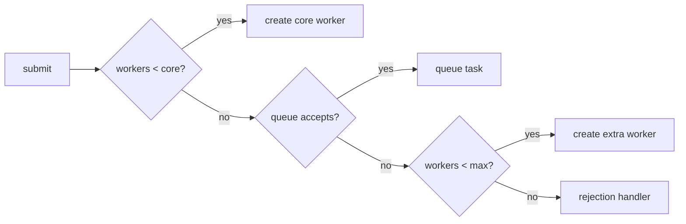

# Lesson 10 — Executors and `ThreadPoolExecutor`

## Interfaces

| Type | Role |
| --- | --- |
| `Executor` | `execute(Runnable)` |
| `ExecutorService` | lifecycle, `submit`, `invokeAll` |
| `ScheduledExecutorService` | delayed/periodic |

## `ThreadPoolExecutor` knobs

- `corePoolSize`, `maximumPoolSize`, `keepAlive`, **work queue** (bounded vs unbounded), **RejectedExecutionHandler**.

```java
ThreadPoolExecutor pool = new ThreadPoolExecutor(
    8, 16, 60, TimeUnit.SECONDS,
    new ArrayBlockingQueue<>(500),
    new ThreadPoolExecutor.CallerRunsPolicy());
```

**CallerRuns** — backpressure on submitter thread.

## Admission sequence and saturation scenario

For each submitted task, the executor first creates workers until `corePoolSize`, then prefers
the queue; only when a queue offer fails does it grow toward `maximumPoolSize`; otherwise it
rejects via the configured policy. `maximumPoolSize` is the **total** thread limit.



```java
new ThreadPoolExecutor(
    5, 20, 60, TimeUnit.SECONDS,
    new ArrayBlockingQueue<>(100),
    new ThreadPoolExecutor.AbortPolicy());
```

With 130 long-running tasks and no completion during submission: 5 run on core workers, 100 are
queued, 15 create additional workers (bringing the total to 20), and 10 are rejected.
`AbortPolicy` throws `RejectedExecutionException`. The queue fills *before* extra threads are
created, and an arriving task that triggers a new worker may begin before an older queued task.
FIFO queue order therefore neither gives global execution order nor completion order when several
workers run. A queue capacity bounds waiting memory; it is not a concurrency limit.

### What I should say in an interview

“I specify core, max, queue capacity, task type, and rejection policy together. A bounded queue
gives local overload control; I never say max means additional threads.”

## Virtual thread executor

`Executors.newVirtualThreadPerTaskExecutor()` — new VT per task ([Lesson 14](14-virtual-threads.md)).

## Cross-links

- [Lesson 11 — Sizing](11-thread-pool-sizing-and-backpressure.md)
- [Lesson 12 — CompletableFuture](12-completable-future.md)
