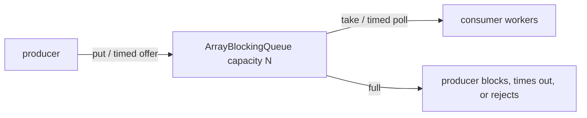

# Lesson 17 — Producer–Consumer Patterns

## In-process architecture

Producers `put`, consumers `take` — decouple rates with a **bounded** buffer.

```java
BlockingQueue<Task> queue = new ArrayBlockingQueue<>(1000);

void producer() throws InterruptedException {
    queue.put(task); // blocks when full — backpressure
}

void consumer() throws InterruptedException {
    Task t = queue.take(); // blocks when empty
}
```

Use `offer(timeout)` / `poll(timeout)` when you need bounded wait; handle interrupt.

## Queue capacity ≠ consumer count

1000-slot queue with **one** consumer still serializes processing — capacity bounds **memory**, not **parallelism**. Scale consumers (thread pool) separately.

## `ArrayBlockingQueue` mechanics

`ArrayBlockingQueue` is fixed-capacity FIFO with one `ReentrantLock` coordinating its circular
array and the `notEmpty` / `notFull` conditions. `add` fails immediately when full, `offer` returns
false, `put` blocks, and timed `offer` waits only for its timeout. On the consumer side, `poll`
returns `null`, `take` blocks, and timed `poll` waits. The optional fairness flag can reduce
barging but costs throughput.



This is **local** backpressure, not distributed backpressure. A Kafka consumer must not block its
poll thread indefinitely on `put`: it can stop polling long enough to violate consumer-liveness
settings such as `max.poll.interval.ms`, causing a rebalance. Pause/resume, bounded work, or an
intentional overload policy is safer.

## Failure, retry, ack

In-memory queue: message **lost** on JVM crash. Retry logic must be idempotent. No Kafka-style consumer group offset — you own application semantics.

## BlockingQueue vs Kafka

| | `BlockingQueue` | Apache Kafka |
| --- | --- | --- |
| Scope | Single JVM process | Distributed cluster |
| Durability | Heap (unless persisted elsewhere) | Log segments, replication |
| Consumption | Remove/take from queue | **Offsets** — records retained per policy |
| Replay | Not built-in | Consumer groups reset offsets / new groups |
| Backpressure | `put` blocks / reject policy | Producer acks, quotas, consumer lag |

Kafka records are **not deleted** merely because a consumer read them; retention and compaction policies apply. Multiple consumer groups can read the same topic independently (partition assignment rules apply).

**Same architecture:** Kafka between services; `BlockingQueue` or disruptor **inside** a service for local fan-out/workers ([Lesson 20](20-advanced-concurrency.md)).

## Cross-links

- [Collections M4 L10](../books/01-engineering-mastery/core-java/module-04-collections/10-blocking-queues-and-backpressure.md)
- [Kafka track](../kafka/index.md)

## 10+ YOE pitch

“Bounded queues implement backpressure in-process. Kafka is the durable, multi-subscriber log between services — complementary, not interchangeable.”
