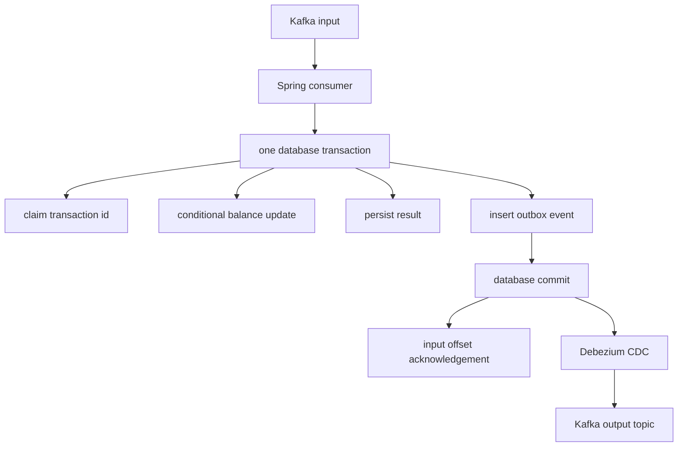

# Database Concurrency and Isolation

Application locks do not replace **database** concurrency control in multi-instance deployments.

## Optimistic locking (`@Version`)

JPA increments version on successful update; stale version → `OptimisticLockException`. Good when conflicts are **workload-dependent** (not a universal “5–10%” rule).

## Pessimistic locking

```sql
SELECT * FROM account WHERE id = 42 FOR UPDATE;
```

Holds row lock until transaction ends — prevents concurrent writers; risk of deadlocks and reduced throughput.

## `FOR UPDATE NOWAIT` / `SKIP LOCKED`

- **NOWAIT** — fail fast if row locked.
- **SKIP LOCKED** — queue workers skip rows already locked (job claiming patterns).

## Atomic conditional updates

Prefer DB-native compare-and-set:

```sql
UPDATE account SET balance = balance - 100
WHERE id = 42 AND balance >= 100;
```

Inspect **rows affected** — application-level read-modify-write is racy across instances.

## Atomic debit: validation and mutation in one statement

```sql
UPDATE accounts
SET balance = balance - :amount
WHERE account_id = :accountId
  AND balance >= :amount;
```

Validate `:amount > 0` at the application boundary and use a fixed-precision monetary type
(`numeric`/scaled integer), not floating point. The database evaluates the predicate and update
as one write operation; inspect the affected-row count. Zero rows means the account was absent,
funds were insufficient, or another concurrent writer changed the predicate outcome—choose an
API response deliberately. A separate `SELECT balance` followed by `UPDATE` has a race window.

For PostgreSQL, `READ COMMITTED` is the default: each ordinary statement sees committed data as
of the statement start, while writers coordinate through row-level locks/MVCC. This is a
PostgreSQL-specific operational model, not a universal statement about every database. Other
writes, transfers spanning rows, and business invariants may require optimistic locking,
`SELECT ... FOR UPDATE`, explicit transaction design, or serializable retry.

## Idempotency claim before an at-least-once debit

A Kafka consumer can commit its database transaction and crash before its input offset is
acknowledged. The same message will be replayed. Use the stable transaction ID as an idempotency
key with a unique constraint; do not use a newly generated ID for each retry. Reject or flag key
reuse when the same key carries a conflicting business payload.

```sql
INSERT INTO processed_transactions (transaction_id, status)
VALUES (:transactionId, 'PROCESSING')
ON CONFLICT (transaction_id) DO NOTHING;
```

Treat “one row inserted” as the right to process and “zero rows” as a duplicate to look up or
return idempotently. PostgreSQL coordinates conflicting unique-index inserts even while the
winning transaction is uncommitted; the loser may wait and then observe the conflict outcome.
That gives an effectively-once **business effect** when combined with the conditional debit,
not a claim of exactly-once Kafka message delivery.

### Hibernate `save`, `flush`, and commit

`save()` registers entity state with the persistence context and Hibernate may defer SQL until a
flush point. `saveAndFlush()` (or `flush()`) forces pending SQL to be sent so a database constraint
can be observed early, but **flush is not commit**: uncommitted rows are still subject to the
transaction/isolation rules and can still roll back. For a consumer claim, an explicit immediate
SQL insert makes the ordering and duplicate result obvious. Avoid holding a transaction while
performing slow external work.

## Transactional outbox



The claim, debit, result, and outbox row commit atomically in one database transaction. The
outbox is separate from input-offset management: a crash after commit but before acknowledgement
causes replay, which idempotency makes safe. An unavailable CDC connector does not roll back an
already committed database transaction. CDC/outbox publication can be duplicated, so downstream
consumers also need idempotency. This is an interview architecture unless implemented and
operated in the stated production system; do not represent it as demonstrated production work.

## Lock ordering

Acquire locks in **deterministic order** across tables to reduce deadlock (same principle as Java locks).

## PostgreSQL MVCC (high level)

Readers generally do not block writers; writers create new row versions; `VACUUM` reclaims dead tuples. Long transactions increase bloat and conflict windows.

## When DB atomic ops beat app logic

Single-row conditional updates, ledger postings, inventory decrements — let the engine enforce invariant in one statement.

## Cross-links

- [Concurrency L22 — Scenario D](../concurrency/22-backend-concurrency-scenarios.md)
- [M8 — idempotency](../books/01-engineering-mastery/core-java/module-08-exception-handling/03-production-spring-retries-idempotency.md)

**Verify:** isolation behavior and syntax for your DB version (PostgreSQL docs for `READ COMMITTED` / `REPEATABLE READ`).
