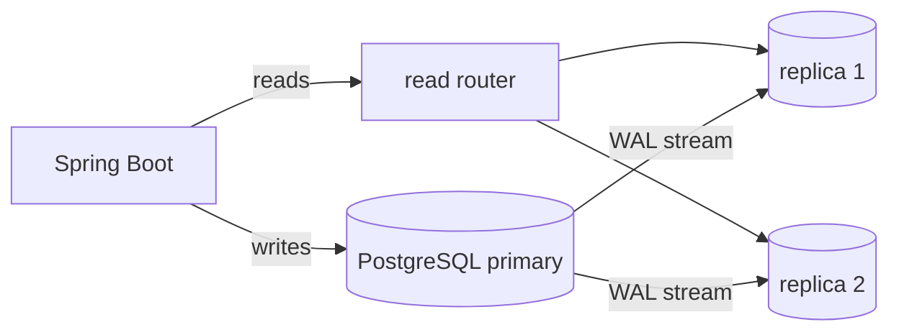
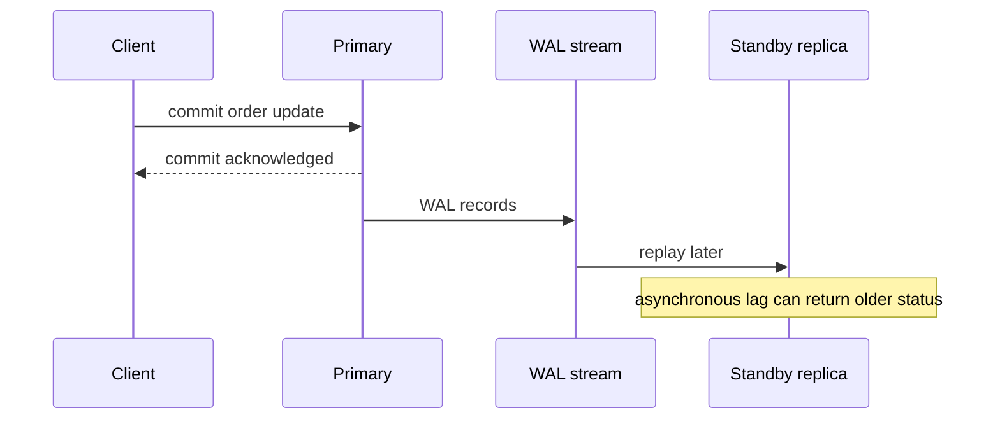
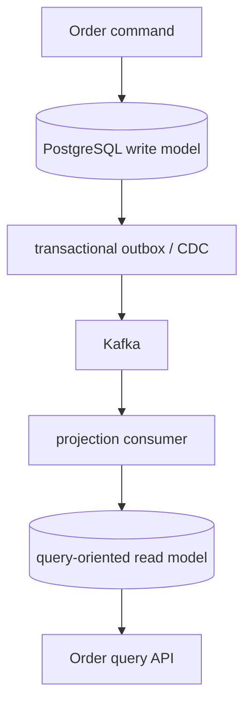
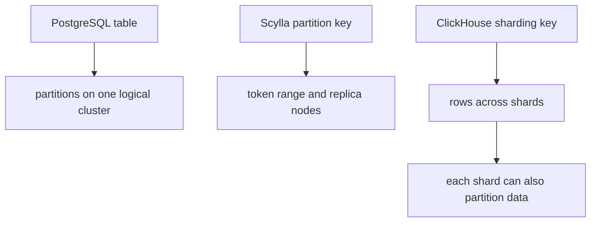

# Database Scaling, Replication, CQRS, and Data Distribution

This is a design guide, not a claim that every service needs a replica, sharding, or CQRS. Start
with the observed bottleneck, the consistency contract, and the simplest mechanism that meets it.

## 1. PostgreSQL read replicas and WAL

A primary accepts writes. A read-only standby can serve suitable read traffic, giving horizontal
read capacity while writes remain on the primary.

PostgreSQL writes write-ahead-log (WAL) records before data pages are considered durable. Physical
streaming replication sends/replays that WAL on a standby, which therefore represents the same
physical database state and normally has the same schema/index structures. Async replication has
lag: a just-committed `SHIPPED` order may not yet be visible to a replica. Route read-after-write
or invariant-critical reads to the primary, measure lag, and state the user-visible policy.
Synchronous replication changes commit acknowledgement behavior, but does not by itself mean
every arbitrary read is automatically strongly consistent; routing and semantics still matter.

## 2. Physical versus logical replication versus CQRS

| Option | What moves | Schema/index independence | Typical purpose | Important limitation |
| --- | --- | --- | --- | --- |
| Physical standby | physical/WAL state | no independent standby schema/index changes | HA and same-schema read scaling | read-only copy; lag |
| Logical replication | selected row changes, publisher to subscriber | subscriber can have its own indexes | subsets, consolidation, integrations | schema compatibility, apply lag/conflicts |
| CQRS projection | transformed domain events/data | fully query-specific model/engine | denormalized query APIs | projection code, replay/idempotency/operations |

Logical replication uses publications and subscriptions and moves data changes by logical
identity, not byte-for-byte blocks. It can replicate selected tables and lets a subscriber be an
independent database with its own indexes, but schema changes are not automatically a denormalized
read model. The subscriber must remain compatible; apply overhead, lag, failure, and write
conflicts require operational design. CQRS goes further by deliberately transforming data into a
query model; logical replication may be an input, not the whole CQRS design.

## 3. CQRS: separate models, not necessarily two databases

CQRS separates command and query models. It can exist within one physical database; separate
read/write databases are only one implementation choice. For `OrderService`, normalized write
tables (`orders`, `order_items`, `payments`, `shipments`) protect transactions and invariants.
A read model can instead expose a denormalized `order_summary(order_id, customer_name,
total_amount, payment_status, shipment_status, last_updated)` for a frequent query API.

The projector must handle duplicate events idempotently, defined ordering, replay, lag monitoring,
and rebuilds. Queries are eventually consistent with the write model unless a specific consistency
path is designed. Choose a single PostgreSQL database for normal transactional/query workload;
physical replicas for same-schema read distribution; logical replication for selected/independent
subscribers; and CQRS only when query shape, joins, aggregates, or scale genuinely justify the
extra model. A simple `GET /orders/{id}` often needs an index, cache, or physical replica—not CQRS.

### What I should say in an interview

“A read replica scales the same read schema and can lag. CQRS changes the query model itself.
I would not add CQRS merely because reads are high; I would first test whether indexing, a cache,
or replicas satisfy the access pattern.”

## 4. PostgreSQL scaling decision guide

| Observed problem | Investigate first | Do not jump straight to |
| --- | --- | --- |
| Slow queries | `EXPLAIN (ANALYZE, BUFFERS)`, selectivity, statistics, indexes, joins | replicas |
| Excessive reads | query shape, caching, replicas and lag contract | sharding |
| Too many connections | HikariCP/PgBouncer, transaction length, admission | an enormous pool |
| High CPU / IOPS | plans, vertical CPU/RAM/IOPS, working set | more app pods |
| Large time-series data | range partitioning, pruning, retention | distributed sharding |
| High write throughput | write/transaction optimization, hot keys; then sharding | cache-only fixes |
| Different read/write models | CQRS projection | a physical replica alone |
| Sustained overload | capacity expansion plus load shedding | unbounded queueing |

`EXPLAIN` estimates a plan; `EXPLAIN ANALYZE` runs it and reports actual execution information, so
use it carefully in production. Index for predicates/order/selectivity, not every column. Check
sequential scans in context: they are often correct for large result sets. Vertical scaling buys
CPU, RAM, and storage IOPS but has cost and a ceiling. Connection pooling reduces connection
overhead; more connections do not make a slow query or lock contention faster. Long transactions
increase contention/bloat windows and make every scaling method less effective.

## 5. Partitioning, sharding, and replication

**Partitioning divides data. Sharding distributes data. Replication copies data.**

| Concept | PostgreSQL | ScyllaDB | ClickHouse |
| --- | --- | --- | --- |
| Partitioning | one logical table split by range/list/hash; pruning/retention | partition key maps rows to token ranges | `PARTITION BY` organizes local parts |
| Sharding | independent primaries plus routing key; native table partitions are not multi-machine sharding | token ownership distributes partitions across nodes | sharding key distributes across shards |
| Replication | standby/logical copies for HA/read needs | replication factor places replicas on nodes | replicas can exist within shards |

PostgreSQL declarative partitioning is one logical table divided into physical pieces, commonly by
date, tenant/list, or hash. Queries that constrain the partition key can prune partitions; detach/
drop makes retention efficient. It does not automatically distribute partitions across machines.
Sharding adds independent database instances, routing, cross-shard query/transaction constraints,
rebalancing, and hot-shard risk.

ScyllaDB's partition key is hashed to a token; token ownership and replication factor place copies
on cluster nodes. Choose a key matching access patterns and guard against a hot partition—one
popular key can bottleneck despite a wide cluster. In ClickHouse, `PARTITION BY` is local data
organization, a sharding key distributes rows over shards, replicas may exist inside each shard,
and `Distributed` tables coordinate cluster queries. `PARTITION BY` is not automatic sharding.

## 6. Future curriculum, deliberately not scheduled

### LRU cache design in Java — future coding/LLD drill

Practice later: `HashMap` plus doubly linked list, O(1) `get`/`put`, remove/move-to-MRU,
head/tail sentinels, capacity one, updating keys, and the `LinkedHashMap` alternative. Then
discuss one-JVM locking and why Caffeine is preferable for many production caches. This is **not
studied or implemented yet**.

### Database selection — future HLD lesson

Later compare PostgreSQL/MySQL, ScyllaDB/Cassandra, Redis, MongoDB, Elasticsearch/OpenSearch,
ClickHouse, warehouses, and CQRS projections by OLTP/OLAP, read/write mix, consistency, joins,
query flexibility, search, growth, hot partitions, distribution, replication/durability, and
operations. This is not scheduled into the immediate interview plan.

## Practice status and cross-links

Read replica fundamentals, physical/logical replication, CQRS distinction, scaling options, and
partitioning/sharding/replication vocabulary are **explained and understood**. Replication
configuration, distributed admission-control implementation, and hands-on PostgreSQL scaling
remain pending.

- [Database concurrency and isolation](database-concurrency-and-isolation.md)
- [Caching and database protection](../spring-microservices/02-production-pr-review-caching-and-resilience.md)
- [Kafka ordering and outbox](../kafka/index.md)
