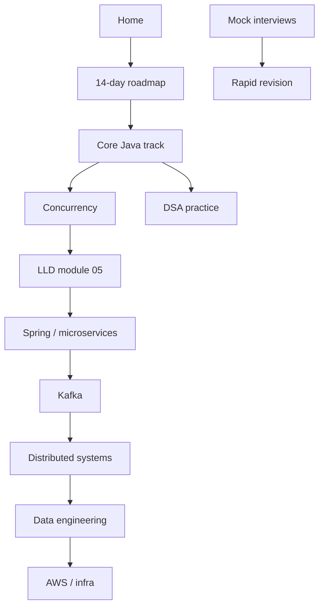

# Senior Engineer Interview Handbook

This handbook is your **single preparation system** for senior backend and data-platform
interviews: Core Java, concurrency, microservices, Kafka, system design, lakehouse
technologies, AWS, DSA practice, and behavioral readiness — without restarting Spark
Modules 1–10 you already completed elsewhere.

## Start here

1. Read [Preparation philosophy](preparation-philosophy.md) (70/30, sequence, interactive style).
2. Open the fixed [14-day roadmap](14-day-roadmap.md).
3. Core Java Modules 4–9: read via [The Three Books](books/index.md) (Mastery → Companion → Playbook).
   Modules 1–3 remain planned; legacy [`docs/java/`](java/index.md) URLs stub to the books.
4. Track honesty in [PROGRESS.md](PROGRESS.md).

## Reading map

## Core Java order (do not skip)

| Order | Module |
| --- | --- |
| 1 | [Object model](java/module-01-java-object-model/index.md) — planned |
| 2 | [`equals()` / `hashCode()`](books/01-engineering-mastery/core-java/module-02-equals-and-hashcode/index.md) — **covered** |
| 3 | [`HashMap` internals](books/01-engineering-mastery/core-java/module-03-hashmap-internals/index.md) — **covered** |
| 4 | [**Collections**](books/01-engineering-mastery/core-java/module-04-collections/index.md) — **covered** |
| 5 | [Generics](books/01-engineering-mastery/core-java/module-05-generics/index.md) — **covered** |
| 6 | [Streams](books/01-engineering-mastery/core-java/module-06-java-8-streams/index.md) — **covered** |
| 7 | [Optional](books/01-engineering-mastery/core-java/module-07-optional/index.md) — **covered** |
| 8 | [Exceptions](books/01-engineering-mastery/core-java/module-08-exception-handling/index.md) — **covered** |
| 9 | [JVM / GC](books/01-engineering-mastery/core-java/module-09-jvm-basics/index.md) — **covered** |

## LLD (module 05-lld)

| Lesson | Path |
| --- | --- |
| 1 — Foundations | [Mastery](books/01-engineering-mastery/lld/module-05-lld/01-lld-foundations-what-senior-lld-interviews-evaluate.md) · [**Companion (interview)**](books/02-interview-companion/lld/module-05-lld/index.md) |

Curriculum hub: [lld/index.md](lld/index.md).

- [Spark Engineering Handbook](../../spark-engineering-handbook/docs/index.md) — canonical Spark and lakehouse foundations (clone as sibling of this repo under `D:\Github`).
- [Interview quick reference](90-reference/interview-quick-reference.md) — condensed recall (grows over time).

## See also

- [How to add lessons](process/adding-lessons.md)
- [Mistakes and misconceptions](mistakes-and-misconceptions/index.md)
