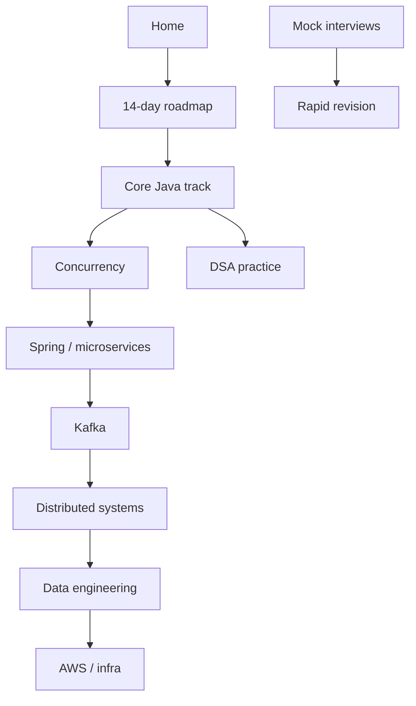

# Senior Engineer Interview Handbook

This handbook is your **single preparation system** for senior backend and data-platform
interviews: Core Java, concurrency, microservices, Kafka, system design, lakehouse
technologies, AWS, DSA practice, and behavioral readiness — without restarting Spark
Modules 1–10 you already completed elsewhere.

## Start here

1. Read [Preparation philosophy](preparation-philosophy.md) (70/30, sequence, interactive style).
2. Open the fixed [14-day roadmap](14-day-roadmap.md).
3. Continue Core Java at [Collections](java/module-04-collections/index.md) — then Generics,
   then Streams.
4. Track honesty in [PROGRESS.md](../PROGRESS.md).

## Reading map

## Core Java order (do not skip)

| Order | Module |
| --- | --- |
| 1 | [Object model](java/module-01-java-object-model/index.md) — planned |
| 2 | [`equals()` / `hashCode()`](java/module-02-equals-and-hashcode/index.md) — planned |
| 3 | [`HashMap` internals](java/module-03-hashmap-internals/index.md) — planned |
| 4 | [**Collections**](java/module-04-collections/index.md) — **in progress** |
| 5 | [Generics](java/module-05-generics/index.md) — planned |
| 6 | [Java 8 Streams](java/module-06-java-8-streams/index.md) — planned |

## External references

- [Spark Engineering Handbook](../../spark-engineering-handbook/docs/index.md) — canonical Spark and lakehouse foundations (clone as sibling of this repo under `D:\Github`).
- [Interview quick reference](90-reference/interview-quick-reference.md) — condensed recall (grows over time).

## See also

- [How to add lessons](process/adding-lessons.md)
- [Mistakes and misconceptions](mistakes-and-misconceptions/index.md)
