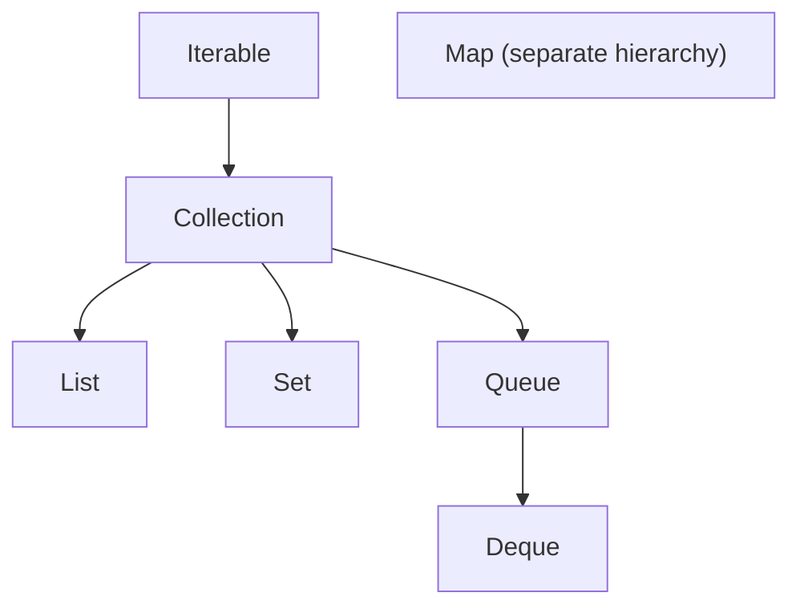

# Lesson 1 — Java Collections Framework Overview

The Java Collections Framework (JCF) is a unified architecture of **interfaces**, **implementations**, and **algorithms** for grouping and manipulating in-memory data. It exists so application code depends on **capabilities** (ordered list, unique set, key lookup) rather than on a single concrete class.

## Overview

- **Java assumption:** JDK 17+ for examples; behavior described matches OpenJDK `HashMap`/`ArrayList` unless noted.
- **Scope:** interface hierarchy, ordering semantics, and selection by access pattern.

## Learning objectives

- Explain why `Map` is part of the JCF but does not extend `Collection`.
- Contrast lists, sets, queues, deques, and maps on ordering, duplicates, and access.
- Distinguish interface contract from implementation performance.
- Distinguish encounter order, insertion order, and sorted order.

## 1. Why the framework exists

Before the JCF, each data structure was ad hoc. The framework standardizes:

- **Polymorphism** — program to `List`, swap `ArrayList` for `LinkedList` when justified.
- **Interoperability** — utilities in `Collections` and streams consume common interfaces.
- **Documented complexity** — interface docs state expected behavior; implementations document amortized/average costs.

## 2. Core interface hierarchy

| Type | Extends `Collection`? | Duplicates | Typical use |
| --- | --- | --- | --- |
| `List` | Yes | Allowed | Indexed sequences, stable order |
| `Set` | Yes | No (by `equals`) | Membership, deduplication |
| `Queue` | Yes | Often allowed | FIFO scheduling (implementation-dependent) |
| `Deque` | Yes (via `Queue`) | Often allowed | Both-end ops, stack/queue |
| `Map` | **No** | Keys unique | Key → value lookup |

`Map` is a **first-class JCF member** (`java.util`) but models **associations**, not a bag of elements. Hence `Map` has `entrySet()`, `keySet()`, `values()` views instead of extending `Collection`.

## 3. Interface vs implementation

| Idea | Interface says | Implementation decides |
| --- | --- | --- |
| `List` | Positional access, allows duplicates | `ArrayList` = array backing; `LinkedList` = nodes |
| `Set` | No duplicate elements | `HashSet` = hash table; `TreeSet` = red-black tree |
| `Map` | Unique keys | `HashMap`, `TreeMap`, `LinkedHashMap`, … |

**Interview trap:** Big-O on the interface is not always guaranteed — read the **implementation** javadoc (`HashMap` vs `TreeMap`).

## 4. Ordering vocabulary

| Term | Meaning |
| --- | --- |
| **Encounter / iteration order** | Order produced by iterator; may be undefined (`HashSet`) or defined (`LinkedHashSet` insertion order) |
| **Sorted order** | Total order from `Comparable` or `Comparator` (`TreeSet`, `TreeMap`) |
| **Insertion order** | Order elements were added (`LinkedHashMap` default, `LinkedHashSet`) |
| **Access order** | Order by last access (`LinkedHashMap` with `accessOrder = true`) |

Sorted order ≠ encounter order: iterating a `HashMap` is not sorted by key.

## 5. Choosing by access pattern

| Dominant operation | Often start with |
| --- | --- |
| Random access by index | `ArrayList` |
| Frequent head/tail queue ops | `ArrayDeque` |
| Unique + fast membership | `HashSet` |
| Unique + sorted traversal | `TreeSet` |
| Fast key lookup, order irrelevant | `HashMap` |
| Key lookup + predictable iteration order | `LinkedHashMap` |
| Key lookup + sorted keys | `TreeMap` |
| Next highest-priority element | `PriorityQueue` |

Ordering guarantees and performance trade off: `TreeMap` pays `O(log n)` for sorted keys; `HashMap` averages `O(1)` without sorted iteration.

## Common misconceptions

| Myth | Reality |
| --- | --- |
| "`Collection` includes maps" | Maps are parallel hierarchy under `Map` |
| "Iteration order equals sort order" | Only for sorted implementations or explicit ordering modes |
| "Pick `LinkedList` for all insertions" | Middle insert on linked lists still requires locating the index — often `O(n)` |

## Revision notes (interview)

- JCF = interfaces + implementations + algorithms.
- `Map` ∉ `Collection`; keys unique, values can duplicate across keys.
- Know **three orderings**: none / insertion or access / sorted.
- Choose implementation by **dominant ops**, concurrency, and memory.

## Key takeaways

- Program to interfaces; justify implementations with complexity and ordering needs.
- Separate **contract** (what) from **implementation** (how fast, what order).

## See also

- Next: [ArrayList vs LinkedList](02-arraylist-vs-linkedlist.md)
- [Map fundamentals](04-map-fundamentals-and-hashmap.md)
- [Selecting the right collection](13-selecting-the-right-collection.md)
