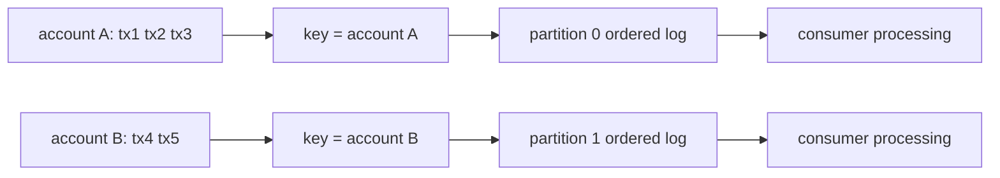

# Kafka for Interviews

**Status: Covered for ordering, consumer coordination, idempotency, and outbox reasoning.**
Broker tuning and a full implementation exercise remain pending.

## Per-account ordering

Kafka preserves record order **inside one partition**, not globally across a topic. Choose
`accountId` as the record key when every transaction for one account must be observed in log
order. A `transactionId` is usually unique, so it spreads transactions of the same account across
partitions and loses that per-account ordering property. Several accounts can still share a
partition; partition order does not make their database updates magically correct.

This relies on a stable partitioning scheme and topic partition count for the ordering interval;
changing partitions changes the key-to-partition mapping for future records. A partition log's
order also does not imply arbitrary downstream asynchronous work, database commits, or external
side effects finish in that order.

### Two consumer designs

| Design | Benefit | Cost |
| --- | --- | --- |
| Sequential processing per partition | Simple offset and failure reasoning | Accounts sharing a partition are serialized |
| Per-account sequential, concurrent across accounts | Better use of independent accounts | Key-aware scheduler, bounded buffering, failure/offset coordination required |

The second design must never acknowledge an offset past unfinished preceding work without a
deliberate ordering/commit strategy. `pause()` / `resume()` can control intake, but a consumer
must continue meeting poll/liveness expectations; long stalls risk `max.poll.interval.ms` expiry
and a rebalance. State whether acknowledgement occurs only after a durable outcome.

### What I should say in an interview

“Kafka gives me per-partition log order. I key by account ID for a per-account sequence, process
a partition serially unless I build a key-aware scheduler, and still use database atomicity and
idempotency for correctness.”

### What not to say

- “Kafka guarantees global order.”
- “Using a key makes database processing exactly once.”
- “A partition's FIFO order guarantees completion order after I dispatch work asynchronously.”

## Roadmap

| # | Topic |
| --- | --- |
| 1 | Architecture — brokers, topics, partitions, leaders |
| 2 | Producers — acks, batching, compression |
| 3 | Consumers and consumer groups |
| 4 | Offsets and commit strategies |
| 5 | Rebalancing and partition assignment |
| 6 | Message ordering guarantees |
| 7 | Delivery semantics overview |
| 8 | At-most / at-least / effective once |
| 9 | Idempotent producers |
| 10 | Transactions |
| 11 | Retries and dead-letter topics |
| 12 | Consumer lag and monitoring |
| 13 | Throughput tuning |
| 14 | Backpressure with consumers |
| 15 | Schema evolution |
| 16 | Microservice integration patterns |
| 17 | Production troubleshooting |
| 18 | Design scenarios (outbox, event sourcing touchpoints) |

Interview framing: trade-offs and failure modes, not broker config trivia alone.
