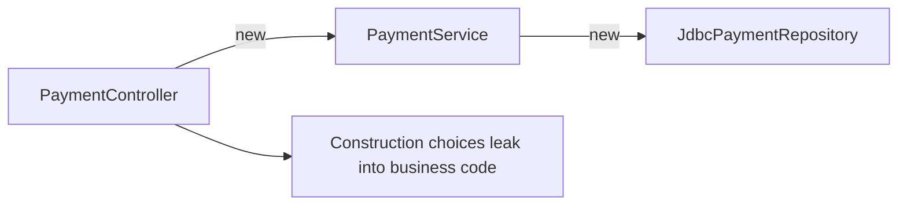
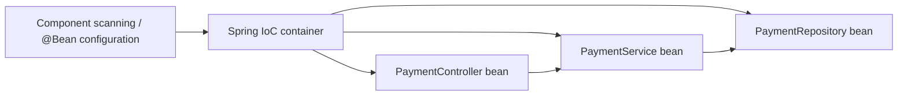
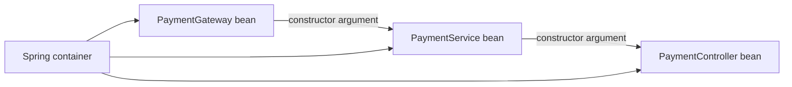

# Spring Core Lesson 1 - Inversion of Control and Dependency Injection

## Scope

This lesson establishes how Spring creates and wires application objects. It introduces container lifecycle and `BeanFactory` / `ApplicationContext` only as responsibilities and interfaces; their dedicated lessons remain later in the Spring Core sequence.

## A. The problem: object graphs built by business classes

Without a framework, application code often constructs its collaborators itself:

```java
public final class PaymentController {
    private final PaymentService service = new PaymentService(
        new JdbcPaymentRepository()
    );
}

public final class PaymentService {
    private final PaymentRepository repository;

    public PaymentService(PaymentRepository repository) {
        this.repository = repository;
    }
}
```

The chain is `PaymentController -> PaymentService -> PaymentRepository`, but consumers are also responsible for choosing and constructing implementations. As constructor requirements grow, construction knowledge propagates outward. Replacing JDBC, adding a client, changing construction order, or providing a test fake requires manual graph assembly in many places. Lifecycles, sharing, configuration, and failure handling become scattered rather than owned in one composition boundary.



Manual construction is not intrinsically wrong. A small program or a test can compose objects with `new`. The problem is allowing feature classes throughout a large backend service to own application wiring.

## B. IoC, DI, and the Spring container

**Inversion of Control (IoC)** is the design principle: object creation, configuration, collaboration, and lifecycle are controlled by infrastructure rather than independently by each business object. Traditional code controls when it constructs dependencies. With IoC, the application declares relationships and a container controls assembly.

**Dependency Injection (DI)** is one technique for implementing IoC: a dependency is supplied to an object rather than constructed or located by that object. **The Spring IoC container** is the framework infrastructure that creates, configures, wires, and manages Spring beans.



IoC is broader than Spring, and DI is not limited to a container: a unit test can use constructor injection manually. Do not use the terms as synonyms.

## C. Container and beans

The container creates beans, resolves and injects their dependencies, manages lifecycle and scopes, and applies infrastructure such as post-processing, proxies, configuration properties, and relevant framework callbacks.

`BeanFactory` is the foundational container interface for bean definition and retrieval. `ApplicationContext` builds on it and is the application-oriented container normally used by Spring Boot; it adds features such as resource loading, events, message resolution, and common integration infrastructure. This is not the full comparison lesson.

A **Spring bean** is an object instance that the container creates or registers and manages. A Java class is only a type definition. Creating `new PaymentService(...)` produces an ordinary Java object; annotating its class does not cause every manually-created instance to become managed.

Component scanning discovers eligible classes in configured packages:

```java
@Service
public class PaymentService { }

@Repository
public class JdbcPaymentRepository implements PaymentRepository { }

@Controller
public class PaymentController { }
```

`@Component` is the general stereotype; `@Service`, `@Repository`, and `@Controller` are specialized stereotypes with clearer intent and, in some cases, framework semantics. Java configuration registers a bean without annotating its class:

```java
@Configuration
class PaymentConfiguration {
    @Bean
    PaymentGateway stripeGateway(StripeClient client) {
        return new StripePaymentGateway(client);
    }
}
```

This is useful for third-party classes, conditional configuration, or construction that needs configuration logic. It does not mean every object in the process is a bean.

## D. Dependency injection choices

Suppose business code depends on a payment boundary:

```java
public interface PaymentGateway {
    PaymentResult charge(PaymentCommand command);
}

@Service
public class PaymentService {
    private final PaymentGateway gateway;

    public PaymentService(PaymentGateway gateway) {
        this.gateway = gateway;
    }

    public PaymentResult charge(PaymentCommand command) {
        return gateway.charge(command);
    }
}
```

Spring resolves the dependency and calls the single constructor; modern Spring needs no `@Autowired` on that constructor. DI separates graph assembly from payment business logic, improves replacement and testing, and makes the required collaborator visible at the API.



| Form | Example | Strengths | Costs / appropriate use |
| --- | --- | --- |
| Constructor | `PaymentService(PaymentGateway gateway)` | Required dependencies explicit; fields may be `final`; object starts valid; simple unit tests; cycles surface early | Best default for required dependencies |
| Setter | `setAuditSink(AuditSink sink)` | Can express genuinely optional or reconfigurable collaboration | Object can be partially initialized; setters add mutable surface |
| Field | `@Autowired private PaymentGateway gateway;` | Short syntax | Hidden dependency, reflection injection, hard direct unit tests, cannot be final; generally avoid |

Setter injection is not always wrong. It can fit an optional feature collaborator or a deliberately reconfigurable integration. It should not conceal a required invariant. Constructor injection is generally preferred because it makes invalid partial construction impossible and does not silently write a private field through reflection.

### Constructor injection and `final`

Spring does not require injected fields to be `final`. `final` is a Java feature that prevents reassignment of a reference after initialization. It does **not** make the referenced `PaymentGateway` immutable, and it does **not** make a singleton service thread-safe. They are complementary practices: constructor injection establishes the collaborator; `final` preserves that reference.

```java
@Service
public final class PaymentService {
    private final PaymentGateway gateway;

    public PaymentService(PaymentGateway gateway) {
        this.gateway = gateway;
    }
}
```

## E. Abstractions and resolution

Depend on an interface when it is a meaningful contract or variation boundary, not merely because a class is injected. `PaymentGateway` is valuable when `StripePaymentGateway` and `RazorpayPaymentGateway` differ behind a stable charge/refund contract, or when provider isolation and test fakes matter. A one-off internal class with no credible variation may be injected as a concrete type; an interface for every class is ceremony without a boundary.

Spring first resolves a normal injection point by type. Two matching candidates cause an ambiguity error unless selection is made explicit.

```java
@Component("stripeGateway")
class StripePaymentGateway implements PaymentGateway {
    @Override public PaymentResult charge(PaymentCommand command) {
        return PaymentResult.accepted("stripe");
    }
}

@Primary
@Component("razorpayGateway")
class RazorpayPaymentGateway implements PaymentGateway {
    @Override public PaymentResult charge(PaymentCommand command) {
        return PaymentResult.accepted("razorpay");
    }
}

@Service
class PaymentService {
    PaymentService(@Qualifier("stripeGateway") PaymentGateway gateway) { }
}
```

`@Primary` selects the preferred candidate for an ambiguous single-bean injection point. `@Qualifier` explicitly narrows the candidate at an injection point. Explicit bean names are the qualifier values in this example. `@Primary` does not remove other beans, and neither annotation creates business routing, provider failover, or health-based selection.

```mermaid
flowchart TD
  need[PaymentGateway injection point] --> candidates[Stripe + Razorpay beans]
  candidates --> primary[@Primary chooses Razorpay by default]
  need --> qualifier[@Qualifier('stripeGateway') chooses Stripe]
  primary --> note[Dependency selection only]
  qualifier --> note
```

## F. Multiple implementations and business routing

For fixed provider strategies, Spring can inject all implementations:

```java
@Service
class PaymentRouter {
    private final Map<String, PaymentProcessor> processors;

    PaymentRouter(Map<String, PaymentProcessor> processors) {
        this.processors = Map.copyOf(processors);
    }
}
```

For `Map<String, PaymentProcessor>`, Spring uses **bean names** as keys. Those keys are not automatically business identifiers such as `"STRIPE"` or `"RAZORPAY"`. Establish a deliberate mapping, for example with processor metadata (`providerCode()`), then build and validate a registry at startup. Detect duplicate codes and missing required providers. This is the Strategy pattern plus registry-based dispatch.

Dependency resolution answers “which collaborators can this object use?” Business routing answers “which provider should this transaction use?” Keep them separate. A provider enum/configuration can select one of the known strategies, but it does not by itself add a new SDK integration.

## G. Unit tests and integration tests

Constructor injection permits a unit test to create the object directly, without an application context:

```java
@Test
void chargesThroughSuppliedGateway() {
    PaymentGateway fake = command -> PaymentResult.accepted("test-123");
    PaymentService service = new PaymentService(fake);

    PaymentResult result = service.charge(new PaymentCommand("tx-1"));

    assertThat(result.status()).isEqualTo(PaymentStatus.ACCEPTED);
}
```

The test verifies object behavior with a fake or mock supplied through the constructor. A Spring integration test starts an `ApplicationContext` to validate component scanning, configuration, qualifiers, bean creation, and actual wiring. They answer different questions; do not turn every unit test into a context test.

## H. Production design

- Prefer explicit constructor dependencies to a service locator (`context.getBean(...)`); the latter hides collaborators and spreads container coupling.
- Twelve constructor dependencies are a design signal: split responsibilities, introduce a focused collaborator, or reconsider orchestration boundaries rather than hiding them with field injection.
- Understand the dependency graph. Constructor cycles are useful feedback that responsibilities are entangled; do not reflexively solve them with `@Lazy`.
- Do not use `new` for an object expected to be Spring-managed. You may bypass configuration, proxies (`@Transactional`, security, metrics), lifecycle callbacks, and its shared managed collaborators.
- Singleton is the default bean scope, not a thread-safety guarantee. Do not keep request transaction IDs, mutable commands, or per-request authentication state in singleton instance fields; pass it as method data or use appropriate request/context facilities.
- DI improves modularity only when the contracts, boundaries, lifecycles, and dependencies are well designed. It cannot repair a service with unclear responsibilities.

## I. Senior interview prompts

1. **What problem does IoC solve, and how does Spring implement it?** Explain separation of graph assembly from business behavior, then beans, container creation, dependency resolution, lifecycle, and infrastructure. *Probe:* which object owns construction in a unit test?
2. **IoC versus DI?** IoC is the control-inversion principle; DI is supplying collaborators as one technique; the container is Spring infrastructure. *Probe:* can manual constructor injection still be DI?
3. **What happens as Spring starts?** At a high level it reads configuration/scans candidates, registers definitions, creates and post-processes beans, resolves dependencies, and applies relevant infrastructure. *Probe:* distinguish this from the dedicated lifecycle lesson.
4. **Why constructor over field injection?** Explicit required inputs, valid/final state, direct tests, and visible cycles. *Probe:* when is setter injection reasonable?
5. **Must every injected dependency be an interface?** No. Use an interface for a meaningful contract or anticipated variation boundary. *Probe:* one provider today but credible future providers - explain cost versus likely change.
6. **Two beans implement one interface; what occurs?** Type injection is ambiguous. Use a qualifier, primary candidate, or inject a collection. *Probe:* explain why `@Primary` is not routing/failover.
7. **How would you support multiple payment providers?** Inject strategies, build an explicit business-code registry, validate duplicates/missing mappings, and keep provider selection separate from bean selection. *Probe:* why are `Map<String, Processor>` keys not automatically enum values?
8. **How does constructor injection improve tests?** A fake/mock is supplied directly; no Spring context is needed for unit behavior. *Probe:* what does an integration test add?
9. **Is a singleton bean thread-safe?** No. Scope controls instance count, not synchronization or safe mutable request state. *Probe:* a field holds the current transaction id - concurrent requests overwrite it.
10. **A developer calls `new` for a class also registered as a bean. What breaks?** The object is unmanaged: no injected managed dependencies, lifecycle callbacks, configuration, or proxy advice. *Probe:* name a transactional behavior that may be bypassed.

## Completion checklist

- [x] Explain IoC, DI, container, and bean as separate concepts.
- [x] Compare constructor, setter, and field injection with trade-offs.
- [x] Explain type selection, `@Primary`, `@Qualifier`, collections, and bean-name map keys.
- [x] Explain direct unit testing versus container integration testing.
- [x] Explain singleton scope, request state, cycles, and unmanaged `new` objects.
- [ ] Independently implement and assess a Spring wiring exercise (separate from conceptual completion).

## See also

- [DIP versus DI in LLD](../books/01-engineering-mastery/lld/module-05-lld/06-ocp-and-dip.md)
- [Concurrency thread-safety patterns](../concurrency/19-thread-safety-patterns.md)
- [Spring Core roadmap](index.md)
