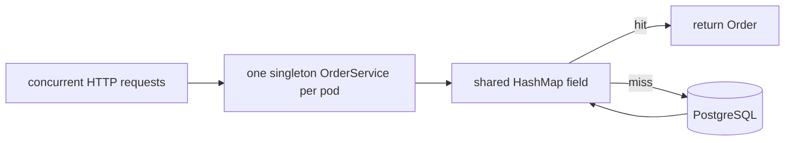
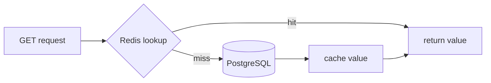
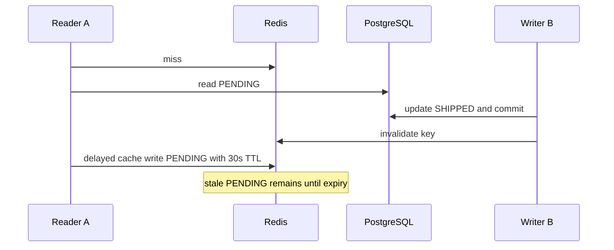
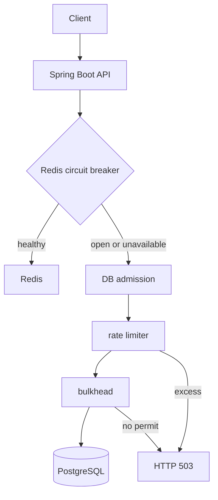
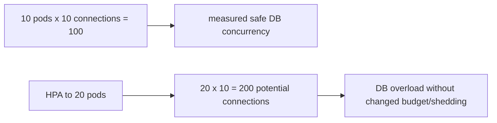

# Spring Boot Production PR Review, Caching, and Resilience

This lesson records a senior-level review of an `OrderService` running on Java 17, Spring Boot
3.x, multiple Kubernetes pods, Redis, and PostgreSQL. PostgreSQL is the authoritative store;
every cache decision must preserve that fact.

## 1. PR review: the original service

```java
@Service
public class OrderService {
    private final Map<String, Order> cache = new HashMap<>();

    @Autowired
    private OrderRepository repository;

    public Order getOrder(String orderId) {
        if (cache.containsKey(orderId)) {
            return cache.get(orderId);
        }
        Order order = repository.findById(orderId).orElseThrow();
        cache.put(orderId, order);
        return order;
    }
}
```



### Shared state, `HashMap`, and compound reads

`@Service` is singleton-scoped by default: a pod has one `OrderService` instance shared by
concurrent request threads. Its `HashMap` is shared mutable state, and concurrent structural
updates are unsafe. `ConcurrentHashMap` is a reasonable first correction, but it only protects
map operations—not staleness, unbounded retention, cross-pod coherence, duplicate loads, or a
mutable `Order` value.

```java
private final ConcurrentHashMap<String, Order> cache = new ConcurrentHashMap<>();
```

`containsKey` then `get` is not atomic. A removal/insertion can interleave, although that is not
automatically a correctness bug if the cache contract makes a miss harmless. It is still needless:
use `get` once. The material risk is a cache stampede: many simultaneous misses can all query the
same expensive row. `computeIfAbsent` atomically establishes a mapping for a key:

```java
Order order = cache.computeIfAbsent(orderId,
    id -> repository.findById(id).orElseThrow(() -> new OrderNotFoundException(id)));
```

Its mapping function can block, repeat after failure, and does not form a transaction with the
database or coordinate other pods. Treat database loading, exception semantics, timeout, and
coalescing as design decisions; do not put arbitrary long-running work in a map callback.

### Constructor injection and deliberate errors

```java
@Service
public final class OrderService {
    private final OrderRepository repository;
    public OrderService(OrderRepository repository) { this.repository = repository; }
}
```

Constructor injection exposes required dependencies, permits `final` references, produces a
fully initialized object, and supports direct unit tests. Field injection hides dependencies and
needs framework/reflection setup. `orElseThrow()` should produce a domain
`OrderNotFoundException` mapped by `@ControllerAdvice` to HTTP 404. A database outage is a
different dependency failure with a considered 5xx/503 policy. Also review validation,
authorization, observability, cache bounds, and whether managed mutable entities escape.

### What I should say in an interview

“I would fix the unsafe singleton state, make dependencies and 404 behavior explicit, then choose
cache scope, bounded retention, freshness, and outage policy. A concurrent map is only a
collection-level correction, not a complete cache architecture.”

## 2. Caching strategies

| Strategy | Reads / population | Writes | Advantage | Main risk |
| --- | --- | --- | --- | --- |
| Cache-aside | app reads cache; app loads DB on miss | DB commit then invalidate/update cache | simple, lazy | stale fills/invalidation races |
| Read-through | integration loads backing store on miss | separate write policy | one cache-facing read API | Redis alone does not do it |
| Write-through | cache layer reads as normal | synchronously attempts DB and cache | warm after write | no cross-store atomicity |
| Write-behind | cache serves accepted data | cache write, durable async persistence | low write latency | loss/order/recovery complexity |
| Write-around | reads may cache | direct DB write, no cache warm | avoids cold write data | next read misses; not invalidation |

### Cache-aside and the other patterns



Cache-aside makes the application responsible for lazy population, TTL, invalidation, and
stampede controls such as coalescing, expiry jitter, bounded refresh, and admission. A common
write path is database transaction, commit, then invalidate the key. Read-through moves miss
loading into a layer; Redis is a data store, not automatic read-through behavior. Write-through
does not make successful PostgreSQL and Redis writes one atomic database transaction; partial
failure needs reconciliation. Write-behind requires a durable log, idempotency, ordering, and
recovery, so naïve use is unsafe for authoritative financial records. Write-around intentionally
bypasses cache population; invalidation removes an existing value and is not the same operation.

## 3. TTL does not guarantee freshness



A 30-second TTL bounds time since the delayed cache write, not age relative to PostgreSQL's last
commit. An in-flight reader can repopulate an invalidated key with an older version; delayed CDC
events can produce a similar race. Version-aware values, per-key coordination, ordered
invalidation/version streams, and a carefully specified protocol can reduce this. Strict
freshness needs an explicit mechanism and often a primary read for balance, entitlement, or
transition decisions. Eventual consistency can be acceptable for product display/history when the
API states it; it is not safe to claim TTL alone provides a maximum database-staleness bound.

## 4. Local cache, Redis, or read database?

| Choice | Strength | Limitation | Good fit |
| --- | --- | --- | --- |
| Local `ConcurrentHashMap` | very fast JVM lookup | pod-only, unbounded by default | tiny controlled state |
| Caffeine | concurrent, bounds/expiry/stats/loading | no cross-pod coherence | hot per-pod reads |
| Redis | shared cache, TTL, optional RDB/AOF persistence | network, invalidation, failure handling | shared hot data/coordination |
| Primary or replica | durable SQL and flexible queries | primary load or replica lag | correctness/same-schema reads |
| CQRS projection | query-specific indexes/data | lag, replay, operations | materially different read shape |

Redis is not necessarily non-durable: RDB snapshots and AOF persistence have configurable
durability/latency trade-offs. Do not cache cheap low-reuse data, values needing strict freshness,
or data whose invalidation risk exceeds the database read cost.

## 5. Redis outage: protect the primary



A circuit breaker is closed while calls succeed, opens after a failure policy to fail fast, then
allows limited half-open probes. It prevents retry storms against a persistently unavailable
Redis. Use short timeouts and bounded retries/backoff/jitter only where a retry is worthwhile.
A `Semaphore` bulkhead (for example `new Semaphore(10)`) limits concurrent in-flight database
work, not requests per second; a rate limiter controls starts per time interval. Combine them
when both risks exist. Use 429 for a client quota violation and 503 for temporary service or
downstream incapacity. Unbounded request queues convert overload into latency, heap pressure, and
timeouts; a queue absorbs a burst but does not create sustainable database throughput.

## 6. Multi-pod budgets and HPA

Ten pods with a 20-connection HikariCP maximum expose 200 potential connections. This is not the
same as 200 executing queries or a request rate, but it can overwhelm a primary safely handling
about 100 concurrent queries. A local pool/semaphore cannot impose a cluster-wide limit.

| Quantity | Meaning |
| --- | --- |
| Pool maximum | connections a pod can open/hold |
| Checked-out connections | connections currently borrowed |
| Executing queries | work consuming DB capacity |
| RPS | arrival rate; may queue before DB access |
| Throughput | completions per second; bounded by bottleneck |

A practical per-pod allocation reserves headroom. If measured safe concurrency is 100, reserve
20 for other services/admin/deploy surge, then distribute an application budget of 80: with a
maximum 10 pods, about 8 connections each. Size for maximum replicas and rolling deployment
surge. Distributed admission control adds a cluster-wide permit budget but introduces leases,
coordinator failure, availability costs, and operations; it is not automatically necessary and
should not rely solely on the failed Redis cache's failure domain.



HPA increases application capacity, not PostgreSQL capacity. Configure `maxReplicas`, per-pod
connection budgets, downstream saturation monitoring, backpressure, and load shedding. CPU-only
autoscaling can worsen a feedback loop when extra pods add DB contention, queueing, and retries.

## 7. Bounded retention and mutable cached values

An unbounded singleton `ConcurrentHashMap<String, Order>` holds strong references for the pod
lifetime. Millions of unique IDs create retained heap, old-generation occupancy, GC pressure, and
possible OOM; the GC cannot collect objects still strongly reachable from the cache.

```java
Cache<String, Order> cache = Caffeine.newBuilder()
    .maximumSize(100_000)
    .expireAfterWrite(Duration.ofSeconds(30))
    .recordStats()
    .build();
```

This is illustrative: choose limits from workload and per-pod heap budgets; monitor hit/miss
ratio, evictions, load latency, cache size, old generation, and RSS. FIFO is oldest insertion,
LRU least recently used, LFU least frequently used, TTL time based, and size/weight policy bounds
memory. Oldest inserted is not necessarily least recently used. Caffeine's access-aware eviction
is not merely a textbook exact-LRU implementation.

**Thread-safe container ≠ thread-safe elements.** Two requests can retrieve the same mutable
`Order`; safe publication of a reference does not make future unsynchronized setters safe. Prefer
immutable `OrderView` DTOs or state clear synchronization/ownership. Likewise, mutating a field
used by `equals`/`hashCode` after adding an object to `HashSet`/`HashMap` can make it unfindable.
The distinction applies to maps, lists, Caffeine, and `CopyOnWriteArrayList`.

## Practice status and cross-links

This material is **explained and understood**. A corrected `OrderService`, independent PR-review
mock, cache-consistency assessment, and production-grade multi-pod fallback implementation remain
pending.

- [Concurrent collections](../concurrency/09-concurrent-collections.md)
- [JVM cache retention](../books/01-engineering-mastery/core-java/module-09-jvm-basics/06-java-reference-types-and-memory-retention.md)
- [Database concurrency](../distributed-systems/database-concurrency-and-isolation.md)
- [Database scaling, replication, and CQRS](../distributed-systems/database-scaling-replication-and-cqrs.md)
