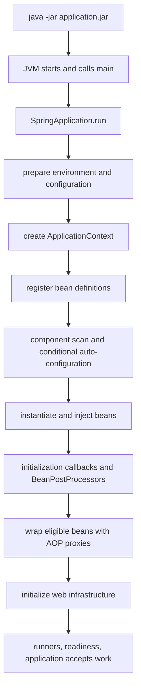
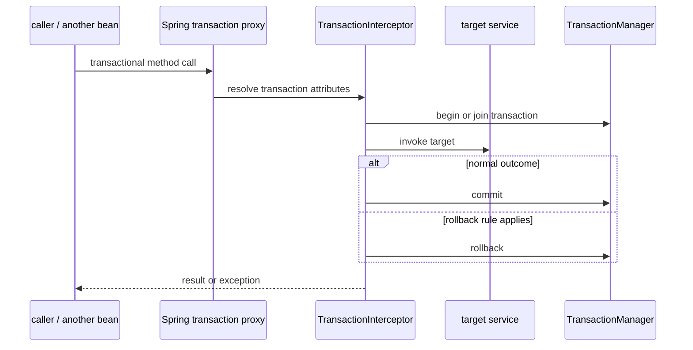
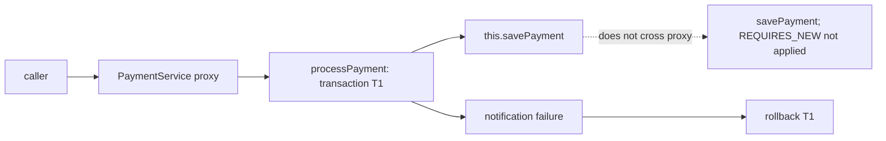
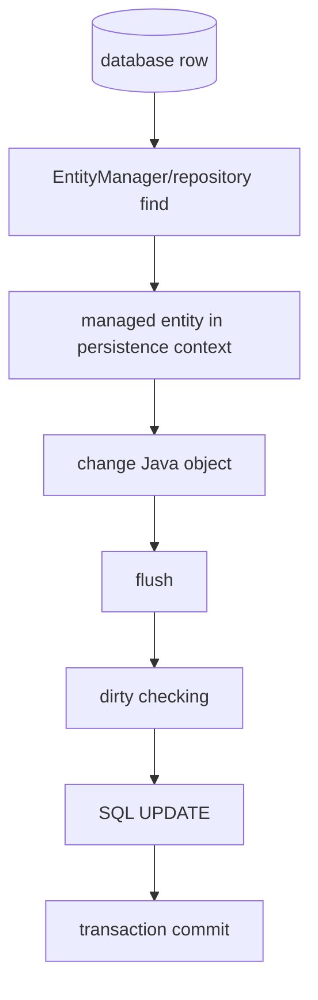
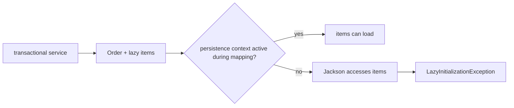
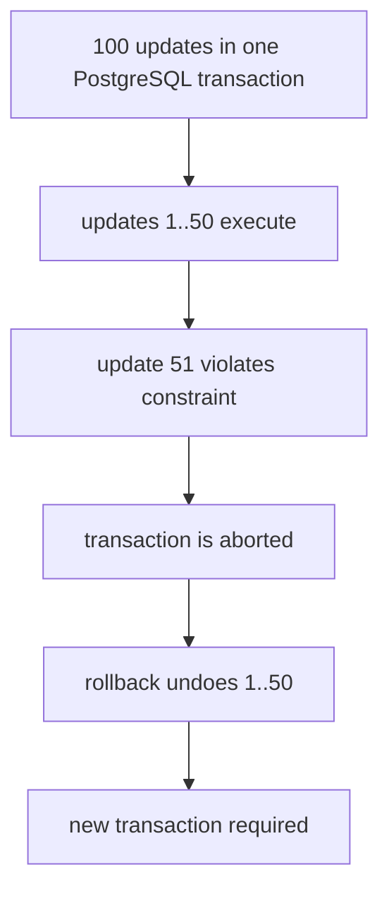
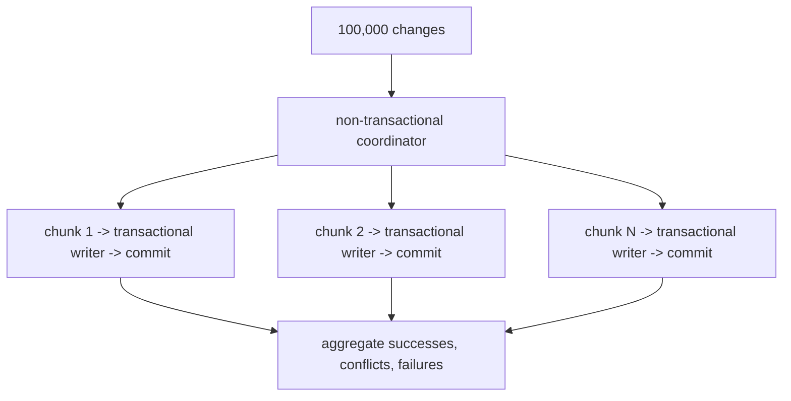
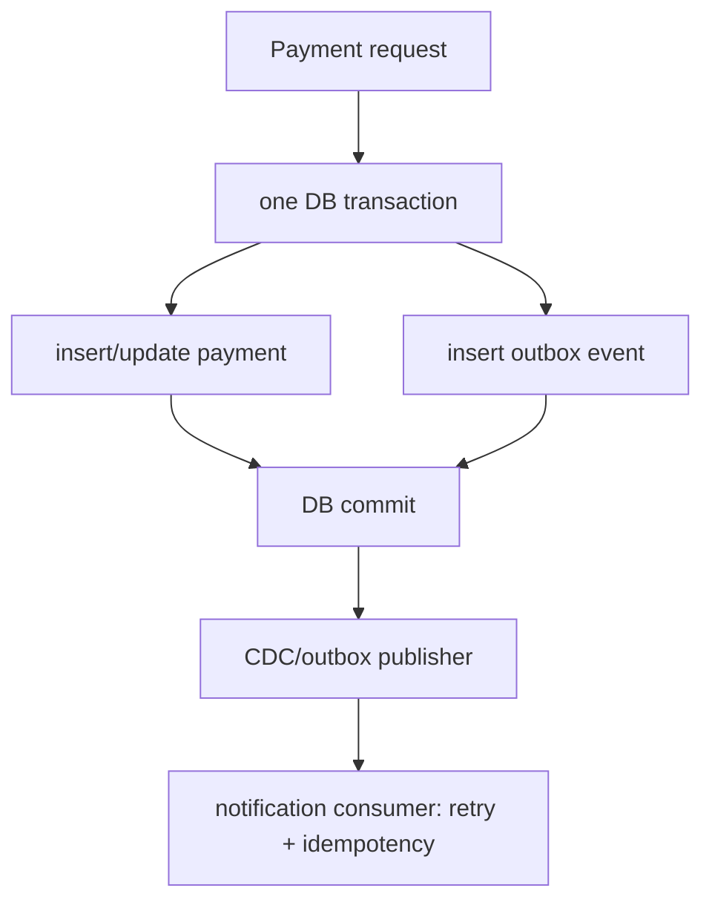

# Spring Boot Internals, Transactions, JPA, and Batch Processing

This incremental chapter is the canonical depth for the Spring/JPA material discussed after the
production-cache review. It records **conceptual coverage**, not independent implementation or
mock-interview validation. For caching, start with the [production PR review](02-production-pr-review-caching-and-resilience.md); for reliable event delivery, see the existing [transactional outbox discussion](../distributed-systems/database-concurrency-and-isolation.md#transactional-outbox).

## 1. Beans, the container, and Boot startup

A **Spring bean** is an ordinary Java object managed by the Spring IoC container. Its object data
lives in the JVM heap; `ApplicationContext` is not a separate memory region. The context holds
bean definitions and references, and manages construction, wiring, lifecycle callbacks,
post-processors, scopes, events, and application infrastructure.

| Term | Meaning |
| --- | --- |
| Bean definition | Metadata explaining how Spring creates/configures a bean. |
| Bean instance | The actual Java object in heap memory. |
| `BeanFactory` | Foundational bean-definition and bean-access container interface. |
| `ApplicationContext` | The usual Boot container; builds on `BeanFactory` with events, resources, messages, and integration infrastructure. |
| Singleton scope | Normally one instance per bean definition **per Spring container**. |
| Prototype scope | A new instance is requested from the container each time; lifecycle ownership differs. |
| Proxy | Another Java object that delegates/intercepts eligible calls to implement infrastructure such as transactions. |

One Kubernetes pod normally runs one application JVM and creates its own `ApplicationContext`.
Therefore, a Spring singleton is not a cluster-wide singleton.



The diagram is a conceptual sequence, not an exact event-by-event implementation trace. Lazy
beans can be constructed later and early references/proxies are special cases. Spring Boot runs in
the same JVM as application code: Java bytecode is interpreted/JIT compiled by that JVM; Spring
does not create a separate execution runtime.

`@SpringBootApplication` combines `@SpringBootConfiguration`, `@EnableAutoConfiguration`, and
`@ComponentScan`. Auto-configuration contributes beans only when conditions match the classpath,
properties, and existing bean definitions; it is not unconditional magic.

### Constructor injection is the default

```java
@Service
final class PaymentService {
    private final PaymentRepository repository;

    PaymentService(PaymentRepository repository) {
        this.repository = repository;
    }
}
```

| Constructor injection | Field injection |
| --- | --- |
| Required dependencies are visible and object construction validates them. | Dependency is hidden and injected reflectively after construction. |
| References may be `final`; ordinary unit tests use `new`. | Fields cannot be `final`; direct tests need reflection or Spring. |
| Circular dependencies normally fail early. | Can obscure a circular dependency. |
| A single constructor needs no `@Autowired`. | `@Autowired` is required for the field. |

`final` prevents reassignment of the reference; it does not make the repository object immutable
or thread-safe.

### Typical lifecycle

```mermaid
flowchart LR
  definition[bean definition] --> instantiate[instantiate]
  instantiate --> inject[dependency injection]
  inject --> before[BeanPostProcessor before initialization]
  before --> init[@PostConstruct / init callback]
  init --> after[BeanPostProcessor after initialization]
  after --> advised{AOP eligible?}
  advised -->|yes| proxied[proxy exposed to other beans]
  advised -->|no| bean[bean exposed]
```

Do not use a self-invoked `@Transactional` method from `@PostConstruct` as a way to start a
business transaction: the bean may not yet be exposed through its final proxy, and startup work
has different readiness/failure semantics.

## 2. AOP proxies and transaction interception

Spring AOP is proxy based. Typical singleton proxies are created during bean initialization by
post-processors. A JDK dynamic proxy implements one or more interfaces; a CGLIB proxy subclasses
the target class. Class-based interception cannot override `final` classes/methods, and neither
style intercepts a `private` method as an overridable virtual call.



This proxy is distinct from a Spring Data repository proxy, a Hibernate lazy entity proxy,
Hibernate dirty checking, and Hibernate's optimistic-lock SQL. Transaction metadata is resolved
by Spring infrastructure; entity state tracking and `@Version` are Hibernate/JPA concerns.

### Self-invocation: annotation present, advice absent

```java
@Service
class PaymentService {
    @Transactional
    public void processPayment(Payment payment) {
        savePayment(payment);            // equivalent to this.savePayment(...)
        sendNotification(payment);
    }

    @Transactional(propagation = Propagation.REQUIRES_NEW)
    public void savePayment(Payment payment) {
        repository.save(payment);
    }

    private void sendNotification(Payment payment) {
        throw new RuntimeException("Notification failed");
    }
}
```



The inner call joins the already active outer transaction through repository work; it is not a
child transaction and does not create T2. Move the separately scoped operation to another bean:

```java
@Service
class PaymentWriter {
    @Transactional(propagation = Propagation.REQUIRES_NEW)
    void save(Payment payment) { repository.save(payment); }
}
```

Calling `writer.save(...)` from `PaymentService` crosses the writer's proxy and can start T2.

## 3. Propagation, rollback rules, and exception paths

`REQUIRED` is the default. It starts a physical transaction when none exists, otherwise it creates
a logical participating scope in the existing physical transaction. `REQUIRES_NEW` suspends the
outer transaction and creates an independent physical transaction; it then resumes the outer one.
The latter needs another database connection while the outer one remains bound, so pool sizing
must accommodate concurrent nested calls.

| Case | Physical transaction(s) | Inner runtime exception caught by outer method | Outcome |
| --- | --- | --- | --- |
| Same-class call | T1 only; inner advice is bypassed | No inner interceptor marks T1 rollback-only. | T1 normally commits unless other code marks it rollback-only. |
| Separate bean, `REQUIRED` | T1 shared by two logical scopes | Inner interceptor marks shared T1 rollback-only. | Outer completion causes rollback and `UnexpectedRollbackException`. |
| Separate bean, `REQUIRES_NEW` | T1 suspended; independent T2 | T2 rolls back; Java exception still reaches outer code. | T1 may commit if it is otherwise valid. |

```mermaid
sequenceDiagram
  participant O as outer proxy/service
  participant W as writer proxy/service
  participant DB as database
  O->>DB: begin T1
  O->>W: REQUIRED call
  W->>DB: join T1, work fails
  W-->>O: RuntimeException; T1 marked rollback-only
  O->>O: catch and return normally
  O->>DB: commit T1 attempt
  DB-->>O: rollback T1
  O-->>O: UnexpectedRollbackException to caller
```

```mermaid
sequenceDiagram
  participant O as outer T1
  participant W as writer proxy
  participant DB as database
  O->>DB: suspend T1
  W->>DB: begin T2
  W->>DB: failure; rollback T2
  W-->>O: RuntimeException
  O->>O: catch
  O->>DB: resume and commit T1
```

The important distinction is between a Java method body returning and a proxied transactional
invocation successfully completing. Transaction independence does not stop ordinary Java
exception propagation.

By default, Spring rolls back for `RuntimeException` and `Error`, but commits for a checked
exception if nothing else has made the transaction rollback-only:

```java
@Transactional(rollbackFor = IOException.class)
void processPayment(Payment payment) throws IOException {
    repository.save(payment);
    throw new IOException("external service failed");
}

@Transactional(noRollbackFor = ExpectedBusinessException.class)
void recordExpectedOutcome() { /* deliberate contract */ }
```

Rules consider exception inheritance. They cannot repair an underlying database transaction that
has already become unusable after a statement failure. **Unchecked -> rollback by default;
checked -> commit by default; `rollbackFor` changes the rule.**

## 4. Persistence context, lazy loading, and fetch design

The persistence context is Hibernate's managed-entity workspace and first-level cache. A managed
entity loaded within it is tracked; a detached entity is not. Dirty checking compares managed
state at flush; flush sends SQL, whereas commit makes the database transaction durable.



```java
@Transactional
void updateOrder(Long id) {
    Order order = repository.findById(id).orElseThrow();
    order.setStatus("SHIPPED"); // managed: save() is normally unnecessary
}
```

Without an outer service transaction (and with OSIV disabled), `findById()` commonly runs in its
own repository transaction and then returns a detached entity; later setters do not persist
automatically. A persistence context can exist without an active database transaction, so do not
equate the two concepts. `save()`/merge matters more for detached state and is not a substitute
for identifying the entity lifecycle.

### Lazy collections and REST

Returning an entity from a controller lets Jackson touch lazy fields after the service returns.
With OSIV disabled, that persistence context is closed and `order.getItems()` can throw
`LazyInitializationException`. With OSIV enabled, serialization may issue database queries late
in the request, holding persistence scope open and concealing N+1 behaviour. One parent with one
lazy collection often produces one additional collection query; N+1 is the list-of-many-parents
case.



Map a DTO inside a read-only transaction when an entity graph is appropriate:

```java
@Transactional(readOnly = true)
OrderResponse getOrder(String id) {
    Order order = repository.findById(id)
        .orElseThrow(() -> new OrderNotFoundException(id));
    return OrderMapper.toResponse(order); // mapping initializes items here
}
```

`readOnly = true` is useful intent/optimization metadata; it is not a universal database-level
write prohibition, nor does it fetch every association. This simple mapping commonly issues the
order query plus the items query, subject to provider/configuration.

| Approach | Managed entity? | Strength | Important limit |
| --- | --- | --- | --- |
| `@EntityGraph(attributePaths = "items")` | Yes | Declarative fetch plan | Provider may choose more than one SQL statement. |
| `LEFT JOIN FETCH o.items` | Yes | Explicit query-local fetch | Collection fetch join plus pagination is risky; `DISTINCT` deals with row duplication, not extra business rows. |
| DTO projection | Not necessarily | Select only endpoint fields | Parent+collection commonly needs two purpose-built queries; reason about snapshot consistency. |

```java
@EntityGraph(attributePaths = "items")
@Query("SELECT o FROM Order o WHERE o.orderId = :id")
Optional<Order> findWithItemsByEntityGraph(@Param("id") String id);

@Query("""
    SELECT DISTINCT o FROM Order o LEFT JOIN FETCH o.items
    WHERE o.orderId = :id
    """)
Optional<Order> findWithItemsByFetchJoin(@Param("id") String id);

@Query("""
    SELECT new com.example.api.OrderHeaderDto(o.orderId, o.status, o.totalAmount)
    FROM Order o WHERE o.orderId = :id
    """)
Optional<OrderHeaderDto> findHeaderById(@Param("id") String id);

@Query("""
    SELECT new com.example.api.OrderItemResponse(i.productId, i.quantity)
    FROM OrderItem i WHERE i.order.orderId = :id
    """)
List<OrderItemResponse> findItemDtosByOrderId(@Param("id") String id);
```

Prefer an entity graph/fetch join for one parent with the needed children, a DTO projection for a
summary or high-throughput read API, and avoid collection-fetch-join pagination in favour of a
two-phase/query-projection design. The header and item DTO queries deliberately use two SQL
queries; if they must observe the same snapshot, choose an appropriate database isolation/transaction
boundary. A fetch join expands SQL result rows for every child. Hibernate can de-duplicate root
entity references in a result list, but that does not remove the row expansion or make collection
fetch-join pagination safe.

## 5. Optimistic locking and bulk updates

For managed entity updates, `@Version` is a conditional compare-and-update performed by the ORM:

```sql
UPDATE orders SET status = 'SHIPPED', version = 6
WHERE id = 101 AND version = 5;
```

```mermaid
sequenceDiagram
  participant T1 as T1 sees version 5
  participant T2 as T2 sees version 5
  participant DB as orders row
  T1->>DB: UPDATE ... version=6 WHERE id=101 AND version=5
  DB-->>T1: 1 row; commit
  T2->>DB: UPDATE ... version=6 WHERE id=101 AND version=5
  DB-->>T2: 0 rows; stale state / OptimisticLockException
```

Hibernate detects the affected-row mismatch around flush and reports an optimistic-lock failure
(`OptimisticLockException`/Hibernate stale-state exception, often translated by Spring). This is
not a Spring transaction-proxy mechanism.

A JPQL `UPDATE` is bulk DML even if it targets one row: it bypasses normal entity dirty checking,
per-entity callbacks, and automatic `@Version` checking. It may leave managed objects stale.

```java
@Modifying(flushAutomatically = true, clearAutomatically = true)
@Query("""
    UPDATE Order o SET o.status = :status, o.version = o.version + 1
    WHERE o.id = :id AND o.version = :expectedVersion
    """)
int updateStatusIfVersionMatches(
    @Param("id") Long id,
    @Param("status") String status,
    @Param("expectedVersion") Long expectedVersion
);
```

An update count of one succeeds; zero can mean missing data or a version mismatch. Incrementing
version in a mass update does **not** itself compare an expected version per row. Automatic flush
protects ordering with pending changes; automatic clear detaches every managed entity, so use it
deliberately.

## 6. Set SQL, Hibernate batching, or JdbcTemplate batching

| Technique | SQL behaviour | ORM involvement | Best fit |
| --- | --- | --- | --- |
| JPQL bulk DML | One set-based statement | Query translation only | Same rule across many rows. |
| Hibernate JDBC batching | Batches compatible entity SQL | Dirty checking, mappings, lifecycle/version behaviour | Many entity changes that need ORM semantics. |
| `JdbcTemplate.batchUpdate` | Direct parameterized JDBC batch | None | Predictable, independent high-throughput writes. |

Hibernate batching needs compatible SQL and configuration; `saveAll()` does not prove that a
batch was formed. Manage persistence-context memory with periodic flush/clear for new entities;
`IDENTITY` identifier generation can limit insert batching, and `flush()` is not commit.

```yaml
spring:
  jpa:
    properties:
      hibernate:
        jdbc.batch_size: 50
        order_inserts: true
        order_updates: true
```

```java
@Transactional
void insertOrders(List<Order> orders) {
    int batchSize = 50;
    for (int i = 0; i < orders.size(); i++) {
        entityManager.persist(orders.get(i));
        if ((i + 1) % batchSize == 0) {
            entityManager.flush();
            entityManager.clear();
        }
    }
    entityManager.flush();
    entityManager.clear();
}
```

This illustration is for new entities and assumes a compatible identifier-generation strategy.
For updates, make sure clearing does not discard managed state needed by later code.

`JdbcTemplate` executes the SQL supplied by the application. It has no entity graph, dirty
checking, or automatic `@Version` support:

```java
public record OrderChange(long orderId, long expectedVersion, String newStatus) { }

String sql = """
    UPDATE orders SET status = ?, version = version + 1
    WHERE id = ? AND version = ?
    """;

int[] counts = jdbcTemplate.batchUpdate(sql, changes, 250,
    (ps, change) -> {
        ps.setString(1, change.newStatus());
        ps.setLong(2, change.orderId());
        ps.setLong(3, change.expectedVersion());
    });
```

The collection overload keeps the data list and batch size together. `BatchPreparedStatementSetter`
expresses the same direct-SQL operation when indexed access fits better:

```java
int[] counts = jdbcTemplate.batchUpdate(sql, new BatchPreparedStatementSetter() {
    @Override public int getBatchSize() { return changes.size(); }
    @Override public void setValues(PreparedStatement ps, int i) throws SQLException {
        OrderChange change = changes.get(i);
        ps.setString(1, change.newStatus());
        ps.setLong(2, change.orderId());
        ps.setLong(3, change.expectedVersion());
    }
});
```

Interpret results conservatively:

| Count | Meaning |
| --- | --- |
| `1` | One row updated. |
| `0` | Expected version did not match, or row was absent. |
| `Statement.SUCCESS_NO_INFO` | Statement succeeded but individual count is unavailable. |
| `Statement.EXECUTE_FAILED` | A failure is reported in batch results where the driver exposes it. |

Drivers differ on batch continuation and update-count reporting. A `BatchUpdateException` may
describe partial execution, but no update is durable until its enclosing transaction commits.

JPA reduces relationship/cascade/lifecycle boilerplate for domain-oriented CRUD. JDBC is often a
better fit for Kafka-driven, large, independent updates with precise SQL and explicit conflict
handling. They can coexist in one Boot app only when datasource and transaction-manager
configuration deliberately coordinates the resources. **JPA manages an object graph; JDBC
executes the SQL you specify.**

For example, JPA is useful when a conventional order service applies relationship rules in one
unit of work:

```java
@OneToMany(mappedBy = "order", cascade = CascadeType.ALL, orphanRemoval = true)
private List<OrderItem> items = new ArrayList<>();
```

Dirty checking, cascade, orphan removal, identity tracking, optimistic versioning, and lifecycle
callbacks can eliminate repetitive persistence plumbing for that model. The JDBC equivalent is
explicit: update the order with a version predicate, insert/delete each item, and enforce the
same invariant and transaction boundary yourself. Parent `@Version` does not automatically guard
every independent child-row mutation.

## 7. Transactional JDBC, chunking, and PostgreSQL errors

`@Transactional` is Spring's transaction abstraction, not a JPA-only feature. With a datasource
transaction manager, `JdbcTemplate` obtains a transaction-bound connection:

```java
@Transactional
void transferMoney() {
    jdbcTemplate.update("UPDATE accounts SET balance = balance - 500 WHERE id = 101");
    jdbcTemplate.update("UPDATE accounts SET balance = balance + 500 WHERE id = 102");
}
```

If the second statement fails and default rollback rules apply, the debit rolls back too.
Without a surrounding transaction, auto-commit can commit the two statements independently.
`DataSourceTransactionManager` is the classic single-datasource JDBC manager;
`JdbcTransactionManager` is its JDBC-oriented variant with exception translation;
`JpaTransactionManager` manages an `EntityManagerFactory` for JPA. JPA and JdbcTemplate can
participate together only when configured against the same underlying datasource/transaction
coordination; arbitrary managers and data sources do not automatically make one atomic unit.



A zero-row version conditional update is normally a successful SQL result, not necessarily a
transaction-aborting error. A constraint violation, deadlock, or SQL error is different. In
PostgreSQL an error normally aborts the current transaction; catching its Java exception does not
make subsequent statements valid. A pre-designed savepoint can isolate a supported recovery
scope, but it is neither free nor an independently committed subtransaction.

For 100,000 independent changes where valid rows should survive conflicts, avoid one enormous
transaction. Use a non-transactional coordinator and a separate proxied writer for bounded
chunks (for example 100--500 after measurement):



Isolate failed chunks, record outcomes, make requests idempotent, and retry only when safe.
Do not blindly retry an optimistic conflict: reread current state, reevaluate invariants, skip a
stale requested change where appropriate, or send it for reconciliation. Catching an optimistic
failure and continuing with the same Hibernate persistence context is unsafe; end/roll back the
affected unit of work. **Optimistic locking detects conflicts; business logic resolves them.**

## 8. Transactional outbox reminder

When payment must remain committed even if notification delivery fails, committing a payment in
`REQUIRES_NEW` is not a durable notification-delivery design. In the same database transaction,
persist the payment change and an outbox row; after commit, a publisher/CDC relay delivers the
event with retries. Consumers must be idempotent because delivery is usually at least once.
External calls inside the database transaction consume connections/locks and can fail after
commit; an in-process after-commit callback alone cannot recover a process crash.



## Review and status

- Conceptually covered: beans/container/startup, constructor injection, lifecycle, AOP proxies,
  propagation, rollback-only, JPA state, fetch plans, optimistic locking, JPQL bulk DML, batching,
  JdbcTemplate transactions, and PostgreSQL aborted-transaction behaviour.
- Needs independent assessment: mixed transaction-propagation mock, JPA/Hibernate implementation,
  production batch writer, and larger Spring Boot PR review.
- Next technical checkpoint: **Spring Security / OAuth2 Resource Server / JWT verification and authorization**.

Authoritative checks: [Spring transaction propagation](https://docs.spring.io/spring-framework/reference/data-access/transaction/declarative/tx-propagation.html), [Spring transaction abstraction](https://docs.spring.io/spring-framework/reference/data-access/transaction/strategies.html), [Spring Data JPA projections](https://docs.spring.io/spring-data/jpa/reference/repositories/projections.html), [Hibernate batching and optimistic locking](https://docs.hibernate.org/orm/current/userguide/html_single/), [Java 17 JDBC batch-result constants](https://docs.oracle.com/en/java/javase/17/docs/api/java.sql/java/sql/Statement.html), and [PostgreSQL transaction isolation](https://www.postgresql.org/docs/current/transaction-iso.html).
