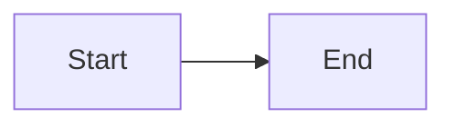

<!--
INTERVIEW COMPANION — CONCURRENCY (Book 2)
Path: docs/books/02-interview-companion/concurrency/NN-slug.md
Canonical: docs/concurrency/NN-slug.md  → link ../../../concurrency/NN-slug.md

Required sections (in order):
1. Canonical source link
2. Definition / Why it exists
3. Must remember
4. Interview traps
5. FAQ
6. Interview flow (Mermaid flowchart or sequenceDiagram)
7. ASCII / table recall (if needed beyond Mermaid)
8. Explain aloud (whiteboard) — 3 bullets
9. JDK and debug clues
10. 30-second revision
11. Memory hooks (optional)
12. Cross-links

Do not copy paragraphs from canonical lessons. Delete these comments before committing.
-->

# Companion N — Lesson Title

**Canonical source:** [Lesson N — Title](../../../concurrency/NN-slug.md).

## Definition

_One or two sentences._

## Why it exists

_Motivation._

## Must remember

- _Bullets._

## Interview traps

- _Trap → fix._

## Frequently asked questions

- **Q:** _?_
  **A:** _._

## Interview flow



## ASCII / table recall

```text
optional
```

## Explain aloud (whiteboard)

1. _Open._
2. _Mechanism._
3. _Trade-off._

## JDK and debug clues

- _Lesson-specific._

## 30-second revision

- _Compressed._

## Memory hooks

- _Mnemonic._

## Cross-links

- [Companion X](NN-slug.md)
