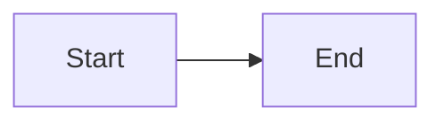

# Companion N — Lesson Title

**Canonical source:** [Mastery lesson](../../../01-engineering-mastery/core-java/module-NN/NN-slug.md).

**Cheat sheet:** [Module visual quick reference](module-visual-quick-reference.md).

## Definition

_One or two sentences specific to this lesson._

## Must remember

- _Topic-specific facts only — no generic boilerplate._

## Interview traps

- _Misconception → correction._

## Interview flow

## Scenario bite

_One backend example (Order, Payment, or Employee) showing the failure or choice._

## Decision table

| Situation | Prefer |
| --- | --- |
| _case_ | _choice_ |

## Explain aloud (whiteboard)

1. _Open._
2. _Mechanism._
3. _Trade-off._

## 30-second revision

- _Compressed facts._

## Memory hook

- _One mnemonic._

## Cross-links

- [Module visual quick reference](module-visual-quick-reference.md)
